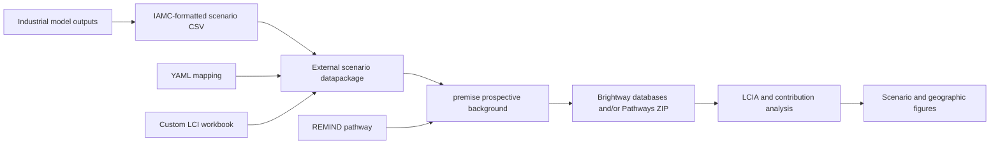

# LCA_TRANSIENCE

### Prospective Life Cycle Assessment Framework for Industrial Transition Pathways

[]()
[](LICENSE)

**LCA_TRANSIENCE** helps you assess how an industrial system could change its environmental footprint as its production routes, feedstocks, imports and wider supply chains change. It connects industrial-model scenarios to life cycle inventories and follows their impacts through future background economies.

The starting point is often a practical question: a model says that a chemical cluster will use a different technology or buy a different feedstock in 2040, but what does that change mean for emissions, resource extraction and the places where those burdens occur? Answering it requires more than assigning a future electricity mix to today's product inventory. The production routes, intermediate markets, trade flows and process boundaries also need to agree with the industrial scenario.

This repository provides that integration layer. It uses [`premise`](https://github.com/polca/premise) to construct prospective inventories and [`Pathways`](https://github.com/polca/pathways) and Brightway to calculate and inspect impacts. It adds the model-specific data preparation, custom inventories, cluster-market definitions, supplier-linking rules, material-supply sensitivities and analysis notebooks needed for the case study. It does not replace those packages or introduce a separate LCA calculation engine.

Developed within the **TRANSIENCE Horizon Europe project**, the main case study is the **Port of Rotterdam (PoR)** chemical cluster under the **CL** and **OCE** industrial scenarios. The active workflow combines a REMIND background, FORECAST inputs and ITOM cluster data. Additional configurations are provided for EDM-I and Open-PROM; their presence in the repository does not mean that every module is active or interchangeable in a given run.

The same approach can be adapted to another industrial cluster, a smaller group of plants or a different product system. The current PoR inventories and geographic rules are a worked case, not universal defaults for those new applications.

> [!IMPORTANT]
> This repository is a research workflow, not a turnkey LCA model. Reproducing a result requires a compatible ecoinvent database, valid `premise` access, the relevant scenario input files, and consistency among the scenario CSV, YAML mapping, inventory workbook, datapackage descriptor, and ecoinvent version.

> [!NOTE]
> **Recommended modelling version: premise 2.5.5.** The current recycling comparisons use this version because its metal-resource correction distinguishes secondary recovery from primary extraction. Earlier inspected inventories could wrongly assign direct virgin-resource flows to recycling activities. This recommendation is specific to the workflow and checks described below, not a claim that every inventory or indicator is now validated. See [why premise 2.5.5 is recommended](#why-premise-255-is-recommended).

## Contents

- [What the framework does](#what-the-framework-does)
- [What this adds to premise and Pathways](#what-this-adds-to-premise-and-pathways)
- [Where to start](#where-to-start)
- [Audience, scope, and conceptual model](#audience-scope-and-conceptual-model)
- [Workflow at a glance](#workflow-at-a-glance)
- [Repository structure](#repository-structure)
- [Installation and access](#installation-and-access)
- [Shared SharePoint or OneDrive inventory](#shared-sharepoint-or-onedrive-inventory)
- [Pre-flight checklist](#pre-flight-checklist)
- [Quick start: Port of Rotterdam](#quick-start-port-of-rotterdam)
- [Detailed workflow](#detailed-workflow)
- [Data contracts and file formats](#data-contracts-and-file-formats)
- [How scenario mappings work](#how-scenario-mappings-work)
- [Port of Rotterdam modelling conventions](#port-of-rotterdam-modelling-conventions)
- [Current external scenario modules](#current-external-scenario-modules)
- [Interpreting results](#interpreting-results)
- [Result data and figure outputs](#result-data-and-figure-outputs)
- [Validation and reproducibility](#validation-and-reproducibility)
- [Assumptions, provenance, and review](#assumptions-provenance-and-review)
- [Troubleshooting](#troubleshooting)
- [Extending the framework](#extending-the-framework)
- [Data requirements and limitations](#data-requirements-and-limitations)
- [Applications](#applications)
- [Related repositories](#related-repositories)
- [Future developments](#future-developments)
- [Contributors and acknowledgement](#contributors-and-acknowledgement)
- [License and citation](#license-and-citation)

## What the framework does

LCA_TRANSIENCE translates modelled industrial transitions into prospective environmental inventories. It is designed to answer questions such as:

- How do alternative industrial transition scenarios change total environmental burdens over time?
- Which products, technologies, supply chains, or life-cycle stages drive those changes?
- How do foreground choices interact with a decarbonizing background economy?
- Which burdens occur in activities located in the Netherlands, explicitly outside the Netherlands, or in geographically aggregated supply chains?
- How sensitive are results to technology deployment, imports, carbon capture and storage, recycling, and energy assumptions?

The framework deliberately separates four kinds of information:

1. **Scenario quantities** — annual production, trade, energy, and technology deployment from external models.
2. **Mapping logic** — rules that connect scenario variables to production pathways and markets.
3. **Inventory content** — process-level technosphere and biosphere exchanges.
4. **Prospective background assumptions** — economy-wide changes supplied by the IAM and implemented by `premise`.

This separation lets you change a scenario quantity without redefining its process recipe, or improve a recipe without editing the industrial model's reported production. You still need to rebuild the affected package and recalculate results. Saved databases and figures do not acquire a new assumption simply because an input file has changed.

For example, a future cluster may obtain methanol from several routes and use it in olefin production. The scenario supplies the route volumes; the mapping decides which inventories represent those routes; the inventories describe their energy, material and emission exchanges; and the prospective background supplies the upstream electricity, fuels and other inputs. The analysis can then compare both the annual cluster footprint and the footprint per unit of product.

## What this adds to premise and Pathways

You can already build prospective LCAs with premise and Pathways alone. Premise supports external scenarios and geographic transformations; Pathways supports multi-scenario calculations, contribution analysis and regionalized methods. LCA_TRANSIENCE supplies a reusable, case-specific workflow around these capabilities. Its added value is the connected modelling decisions and checks, not an exclusive capability that the underlying packages lack.

| Question | Role of the underlying tools | What is provided here |
| --- | --- | --- |
| How does the background economy change? | Premise transforms the source LCI database using supported IAM and external-scenario inputs. | A configured scenario composition linking the background to industrial-model data, with explicit input paths and export steps. |
| What happens in a particular cluster or group of plants? | External scenarios can add technologies and markets, but the foreground boundary and mapping must be supplied. | ITOM converters, route- and mode-specific mappings, custom process inventories, local markets and checks on production and trade reconciliation. |
| Do copied local processes actually buy from the intended suppliers? | Native transformation and linking provide the starting inventory graph. | Post-update supplier resolution, protected import and renewable-power recipes, topology-aware geographic choices, link audits and cycle checks. |
| What changes if more metal input is secondary? | Native premise modelling supplies the baseline metal inventories and markets. | Optional, documented non-ferrous recycled-input sensitivities controlled from notebook 1, with actual-share audits and retained recycling burdens. Steel remains endogenous. |
| Where in the supply chain are impacts attributed? | Pathways calculates location- and activity-resolved contributions. | A geographic analysis notebook distinguishing NL, foreign countries and unresolved aggregate geographies, with scenario comparisons and exportable figures. |
| Does the same emission or resource use have different impacts in different places? | Pathways can use EDGES regionalized characterization. | A separate EDGES notebook with selected methods, location checks and result provenance, kept distinct from ordinary geographic contribution analysis. |
| Can another researcher follow the calculation? | The packages expose the data and calculation interfaces. | Input snapshots, configuration files, reviewed compatibility adapters, classification safeguards, focused tests and the accompanying modelling documentation. |

### Industrial clusters without a new IAM region

A cluster does not have to be an IAM region to be modelled as a foreground system. You can represent its plants, routes and local intermediate markets explicitly while drawing on national, European and global background suppliers. This is useful when a national industrial average would hide the transition being studied.

In the PoR case, many foreground activities have location `NL`, while the selected technology names, scenario volumes and replacement rules identify the cluster system. That is sufficient for a cluster-specific production model, but **`NL` is not a Port of Rotterdam coordinate or boundary**. A result attributed to NL can also contain upstream Dutch activities outside the port. Adding a smaller foreground system does not automatically provide plant-level emission locations or finer regionalized characterization.

### Three different meanings of regionalization

The distinction matters when you explain results to someone who did not build the model:

1. **Supplier regionalization changes the inventory links.** An eligible process may obtain an input from a more appropriate NL or European supplier, while an explicitly imported product keeps its foreign origin. Supplier choice is based on the modelled supply and geographic rules, not on selecting the lowest impact score.
2. **Geographic contribution analysis groups calculated burdens.** Notebook 3 asks which activity locations contribute to the result. Grouping an existing result does not change its exchanges or characterization factors.
3. **Regionalized LCIA changes the characterization of relevant flows.** Notebook 4 uses EDGES for supported location-sensitive impacts. Its interpretation depends on geographic coverage, flow matching and the method's spatial resolution.

These analyses can complement one another, but they do not answer the same question. The [regional case-study guidance](#develop-a-new-regional-case-study) explains what needs to change when moving beyond the current NL/PoR application.

### Primary and secondary materials in context

The material scenarios change the recycled-input share of selected **non-ferrous background markets**. A polymer can therefore benefit through metals used in electricity infrastructure, equipment, catalysts or other upstream inputs, even if its own resin recipe is unchanged. Which of those chains matters must be established by contribution analysis rather than assumed.

This is not a model of local plastic collection or polymer recycling, and it does not solve global scrap availability. The supported options include a version-native `baseline`, a fixed reference case and alternative recycling sensitivities. Existing recovery inventories and their burdens are retained. More ambitious shares are conditional modelling assumptions, not proof that the required scrap quantity and quality will be available.

The distinction between a configured target and an applied market share is central. An absent or differently graded market may not be changed by a rule that looks relevant by name. The lithium example is documented in the [metals policy guide](docs/metals_scenario_policy.md): generic GLO carbonate is supported, but battery-grade GLO markets remain native, and the inspected RELICS lithium definition does not cover `Spodumene`. A small indicator change must not be presented as evidence that lithium recycling offers little benefit.

## Where to start

You do not need to read every implementation note before opening the project. Choose a route that matches what you are trying to do:

| Your starting point | Suggested reading and first action |
| --- | --- |
| You want to understand the study | Read the scope and workflow below, then the [PoR modelling conventions](#port-of-rotterdam-modelling-conventions) and [result interpretation](#interpreting-results). No calculation is needed to understand these boundaries. |
| You have an existing package and want to analyse it | Confirm its scenario, year, ecoinvent version and material case. Start with notebook 2, then notebook 3; use notebook 4 when regionalized characterization is part of the question. |
| You want to reproduce the PoR calculation | Follow [installation and access](#installation-and-access), the pre-flight checklist and the PoR quick start. Obtain the licensed inventories and industrial data before beginning a full build. |
| You want to adapt it to another cluster | First define the products, plants, imports, exports and functional demand. Then use [extending the framework](#extending-the-framework); do not start by replacing every `NL` string with another country. |
| You want to change a process or recycling assumption | Find the owning inventory, mapping or share input, record the change, and test one scenario/year before rebuilding the full study. Read the relevant assumptions guide first. |

For a first calculation, choose one scenario and one year, keep the native metals baseline, and write a Pathways package without also exporting every scenario to Brightway. Check that a small, understandable result is correct before enabling extra years, material sensitivities or regionalized methods. This reduces debugging time without replacing scientific validation.

Some essential inputs are licensed or shared separately and are not supplied by a Git clone. If those files are unavailable, you can still inspect the configuration, contracts and tests, but the repository does not provide a substitute dataset that reproduces the published or local study results.

## Audience, scope, and conceptual model

### Intended users

The repository is intended for researchers and analysts who are comfortable with at least one of the following areas:

- life cycle inventory modelling in ecoinvent and Brightway;
- prospective LCA with `premise`;
- industrial-energy or technology-optimization model outputs;
- IAMC-formatted scenario data;
- Python and notebook-based scientific workflows.

New users do not need to understand every model internally, but they do need to understand the physical meaning, unit, geography, and system boundary of every scenario variable they connect to an LCI.

### What is inside and outside the model

The PoR implementation models annual production associated with the chemical and petrochemical cluster and connects that foreground system to prospective upstream supply chains. Its exact boundary depends on the active ITOM variables and YAML replacements.

Conceptually, the calculation includes:

- foreground production and transformation activities represented by PoR inventories;
- imported intermediates and feedstocks represented through external suppliers;
- electricity, steam, heat, fuels, transport, and material inputs linked to background inventories;
- direct emissions and selected carbon-capture or storage exchanges;
- prospective upstream changes from the REMIND/`premise` background;
- annual scenario-dependent production volumes and supplier shares.

It does not automatically include:

- every industrial activity physically located in the port;
- capital goods or infrastructure omitted from the selected inventories;
- transport burdens where the transport distance is unknown and no explicit assumption is supplied;
- emissions or flows present only as economic bookkeeping in ITOM unless they are deliberately mapped;
- a spatial distinction between the Port of Rotterdam and other activities carrying the generic `NL` location;
- consequences outside the attributional cut-off system model unless explicitly represented.

### Foreground, background, and scenario layers

| Layer | Role | Typical source | Main files |
|---|---|---|---|
| Industrial scenario | Determines how much is produced, imported, exported, stored, or supplied by each route | ITOM, FORECAST, EDM-I, Open-PROM | `scenario_data/*.csv` |
| Mapping | Translates scenario variables into LCI pathways and market shares | Analyst-defined configuration | `configuration_file/*.yaml` |
| Foreground inventory | Describes material, energy, emission, and service exchanges per unit of product | ecoinvent adaptations and technology data | `inventories/*.xlsx` |
| Prospective background | Changes electricity, fuels, materials, transport, and other upstream systems over time | REMIND through `premise` | Generated inside the package workflow |
| Impact assessment | Characterizes inventory flows and aggregates contributions | Brightway methods through `pathways` | `2_calc_impacts.ipynb` |
| Geographic attribution | Groups contribution results by activity location | Result metadata | `3_regionalization_impacts.ipynb` |
| Regionalized LCIA | Applies location-specific characterization, then attributes contributions geographically | EDGES through Pathways | `4_edges_regionalized_impacts.ipynb` |

### Key terminology

| Term | Meaning in this repository |
|---|---|
| **IAMC data** | A wide scenario table with model, scenario, region, variable, unit, and year columns. |
| **External scenario** | A `premise` datapackage that modifies foreground technologies or markets using non-IAM scenario data. |
| **Production pathway** | A YAML entry connecting one scenario volume to one provider activity. |
| **Market** | A scenario-dependent mixture of production pathways that can replace selected supplier exchanges. |
| **Foreground variable** | A scenario variable selected as a functional demand for Pathways calculations, commonly prefixed with `FE_` after package construction. |
| **Reference database** | A Brightway database used to inspect and link custom inventories before future transformations are applied. |
| **Prospective database** | A scenario- and year-specific database containing future background and foreground transformations. |
| **Contribution** | The characterized impact associated with a contributing activity, product, location, or classification. |
| **Credit** | A negative contribution caused by a negative exchange, avoided product, substitution, or carbon-storage convention. |
| **Aggregate geography** | A location such as `RER`, `EUR`, `GLO`, or `RoW` that cannot be assigned to one country from the result metadata alone. |

## Workflow at a glance



For the PoR case, the normal execution order is:

1. Convert the CL and OCE ITOM workbooks with `0_convert_ITOM_por_to_IAMC.py`.
2. Review the scenario data, YAML mapping, and custom inventory workbook.
3. Run `1_export_packages.ipynb` to assemble the prospective scenarios and create `results/datapackages/remind-transience_por.zip` and/or Brightway databases.
4. Run `2_calc_impacts.ipynb` to calculate and export LCA results.
5. Run `3_regionalization_impacts.ipynb` to compare the activity-location distribution of impacts.
6. Run `4_edges_regionalized_impacts.ipynb` for location-specific water-scarcity, particulate-matter and acidification characterization using EDGES.

## Repository structure

```text
lca_transience/
├── 0_convert_ITOM_por_to_IAMC.py   # Convert CL and OCE ITOM outputs to IAMC data
├── 0_export_act_to_excel.py        # Extract candidate ecoinvent activities for LCI development
├── 1_export_packages.ipynb         # Build prospective databases and the Pathways package
├── 2_calc_impacts.ipynb            # Calculate LCIA results and scenario figures
├── 3_regionalization_impacts.ipynb # Attribute results by activity location
├── 4_edges_regionalized_impacts.ipynb # EDGES regionalized LCIA and geographic comparisons
├── config.py                       # Brightway, ecoinvent and shared input/output paths
├── configuration_file/             # External-scenario YAML mappings
├── inventories/                    # Custom Excel inventory workbooks
├── scenario_data/                  # IAMC scenario CSVs and source model workbooks
├── datapackages/                   # External-scenario datapackage_*.json descriptors
├── supplier_resolution.py          # Shared supplier identities and active-IAM geography
├── por_supplier_linking.py         # Post-update supplier linking and export guards
├── inventory_supplier_compat.py    # Reviewed supplier-version compatibility rules
├── premise_compat.py               # premise compatibility and native inventory access
├── por_classifications.py          # Classification export and complete Pathways grouping
├── por_scenario_inputs.py          # Fresh scenario inputs and p-xylene purity reconciliation
├── metals_scenario_policy.py       # Non-ferrous policy, update hooks and package provenance
├── primary_vs_secondary_metals/    # Supporting metal-market transformation code
├── figs/                           # Generated figures and selected plot data
├── results/                        # Generated analysis artifacts; not scenario inputs
│   ├── datapackages/               # Pathways ZIPs, including remind-transience_por*.zip
│   ├── impacts/                    # Ordinary LCIA results_*.gzip Parquet exports
│   ├── edges/                      # EDGES results_edges_por_*.gzip and JSON sidecars
│   └── input_snapshots/            # Hash-addressed LCI snapshots and staging manifests
├── requirements.txt               # Default premise 2.5.2 pip profile
├── requirements-common.txt        # Shared reviewed numerical/runtime pins
├── requirements-legacy.txt        # Optional premise 2.3.8 comparison profile
├── lca_transience.yml              # Portable Conda setup for the default profile
├── lca_transience_legacy.yml       # Separate optional legacy Conda setup
└── README.md
```

### Consolidated helper modules

The framework has seven top-level helper modules, organized by responsibility.
Scenario reconciliation is in `por_scenario_inputs.py`; classification export
and Pathways grouping are in `por_classifications.py`; non-ferrous policy and
its export workflow are in `metals_scenario_policy.py`; premise compatibility
and certified inventory-store access are in `premise_compat.py`. Supplier
resolution, post-update linking and reviewed inventory compatibility remain
separate because they serve different stages of the workflow.

For a normal calculation, you work mainly with the numbered notebooks and their
input settings. The helper modules enforce the shared rules; they are not a
second series of scripts that must be run by hand. Older helper names were
consolidated into the modules above rather than kept as forwarding wrappers.
Restart an existing notebook kernel after updating the code so that imports use
the current functions. A module refactor alone does not change scenario quantities,
LCI exchanges or modelling assumptions.
See [helper responsibilities and import migration](docs/helper_modules.md).

### Generated files

The workflow can produce large local artifacts, including:

- `results/datapackages/remind-transience_por.zip` — the Pathways datapackage used for calculations;
- scenario-specific Brightway databases;
- `results/impacts/results_YYYYMMDD_HHMMSS.gzip` — ordinary exported calculation results;
- `results/edges/results_edges_por_*.gzip` and their JSON sidecars — separate regionalized EDGES results and calculation provenance;
- `pathways.log`, `edges.log`, and `unlinked.log` — diagnostic logs;
- PNG and PDF figures in `figs/`.

Most generated databases, archives, credentials, and temporary files should remain local. Check `.gitignore` before adding outputs to version control.

Input descriptors and generated scenario archives are deliberately separate:
`datapackages/` contains the small JSON inputs; `results/datapackages/` contains
the generated ZIPs consumed by notebooks 2 and 4. The shared paths and artifact
resolvers live in `config.py`: `DATAPACKAGE_DIR`, `PACKAGE_OUTPUT_DIR`,
`IMPACT_RESULTS_DIR` and `EDGES_RESULTS_DIR` are rooted at `ROOT`, the repository
directory. New result exports go into their respective
subdirectories, so notebook 3 does not accidentally select an EDGES run as an
ordinary LCIA run. Figures remain in `figs/` and diagnostic/audit reports remain
in `export/`; those directories have not been moved.

Existing archives and saved result files are relocated without recalculation or
changes to their contents. Reusing an existing package name on a subsequent
build replaces that generated ZIP, as before; preserve a separately named copy
when an earlier run must remain reproducible. JSON sidecars stay beside their
EDGES result file.

## Installation and access

### Prerequisites

You need:

- Git;
- Conda or Mamba;
- a Python version compatible with the chosen environment; the current premise 2.5.5 working environment uses Python 3.12;
- a licensed ecoinvent account with access to the required database release;
- a valid `premise` key;
- JupyterLab, Jupyter Notebook, or an IDE capable of running notebooks;
- the project-specific scenario files required by the modules you activate.

For new work on this case study, use **premise 2.5.5 with Brightway 2.5** and keep
that environment separate from older comparison installations. The inspected
working setup uses Python 3.12.15, ecoinvent 3.12 cut-off and a pinned Pathways
source revision. Its installed packages pass `python -m pip check`.

There are three version choices to keep separate: the premise release, the
ecoinvent inventory release and the LCIA factor set used by Pathways. Selecting
premise 2.5.5 does not automatically select ecoinvent 3.12 characterization factors
or establish that a resource indicator covers all relevant flows.

### Why premise 2.5.5 is recommended

The reason is methodological as well as technical. Premise corrects some metal
resource exchanges to address distortions caused by allocation in primary
production. That correction must distinguish primary extraction from secondary
recovery. In the earlier inspected 2.5.2 exports, recycling activities such as
copper-scrap electrolytic refining and cobalt recovery from used batteries could
receive direct virgin-metal resource exchanges. Increasing their market shares
could then appear to increase extraction from nature for the wrong reason.

The inspected **2.5.5 implementation identifies secondary activities before
applying the primary-resource correction**. Checks on the newer exports confirmed
that the affected copper and cobalt recovery activities no longer had those
spurious direct resource inputs. This makes 2.5.5 the recommended starting point
for the repo's recycled-input comparisons. The correction does not make recycling
burden-free: its electricity, chemicals, infrastructure, emissions and upstream
resource requirements remain part of the LCA.

This is not a blanket guarantee that all metal results are complete. Market-grade
coverage, allocation, supplier recipes and characterization still need checking.
In particular, the lithium limitations described in the [metals guide](docs/metals_scenario_policy.md#generic-lithium-carbonate-and-upstream-hydroxide-22-october-2026)
remain separate from the copper/cobalt correction. Native premise baselines also
remain version-dependent; switching versions is a model change, not just a faster
way of reproducing the same database.

### Environment profiles and what the files currently install

The recommendation above is newer than the portable dependency snapshots in the
repository. **The commands `pip install -r requirements.txt` and `conda env create
-f lca_transience.yml` still select premise 2.5.2, not 2.5.5.** Those files have
not been silently repinned by this documentation update. Use the explicit 2.5.5
recipe below for the recommended setup, or use the older files deliberately when
reproducing an earlier calculation.

| Purpose | premise | Python | Pathways source revision | How to select it |
| --- | --- | --- | --- | --- |
| Recommended current modelling setup, checked locally on 22 October 2026 | 2.5.5 | Inspected working environment: 3.12.15 | `a7d510d45192b5f95c76360e78a89224abea97e4` | Explicit installation recipe below; verify the resulting environment. |
| Retained earlier installation profile | 2.5.2 | 3.11 | `82e736438d13c7b465361914534229cf3860bf46` | `requirements.txt` or `lca_transience.yml`. |
| Optional legacy comparison | 2.3.8 | 3.11 | `f9187faeab92be4dd7a9fe5e90256870b33bc618` | `requirements-legacy.txt` or `lca_transience_legacy.yml`, in a separate environment. |

The inspected Pathways builds report the same package version, 1.0.4, despite
different source revisions. Record `direct_url.json` as well as the version label.
The [environment guide](docs/environment_setup.md) explains the retained
2.5.2/2.3.8 manifests, shared dependencies and legacy setup. It should not be read
as a claim that those files install the recommended 2.5.5 stack.

### Clone and create the environment

```bash
git clone https://github.com/tomterlouw/lca_transience.git
cd lca_transience
conda create -n lca_transience_255 -c conda-forge python=3.12 pip git
conda activate lca_transience_255
python -m pip install -r requirements-common.txt "premise[bw25]==2.5.5" "pathways @ git+https://github.com/polca/pathways.git@a7d510d45192b5f95c76360e78a89224abea97e4" "bw-processing==1.5" "matrix-utils==0.8" "lxml==5.4.0"
python -m pip check
```

The long pip command is one command; the quotes also work in PowerShell. It
combines the shared direct dependency pins with the observed 2.5.5 core choices,
rather than installing the 2.5.2 profile and assuming that its name means
"latest". Git is needed to install Pathways at the specified revision.

If you use Mamba, substitute its environment creation command and then run the
same pip installation in the activated environment:

```bash
mamba create -n lca_transience_255 -c conda-forge python=3.12 pip git
```

If that environment name already exists, use a different name for a clean test.
Do not overwrite a working modelling environment simply to follow an example.
Run the commands from the repository root, and register a matching notebook
kernel after checking the installation.

This recipe documents the inspected interpreter family and core package choices;
it is **not a fully resolved, hash-locked environment**. A fresh installation has
not been created as part of this README rewrite. Resolver changes and platform
differences can affect transitive packages, so run the checks below and retain
the resolved environment with any result you plan to archive or publish.

To reproduce the retained **2.5.2** profile instead, use its existing files in a
separate environment:

```bash
conda env create -f lca_transience.yml -n lca_transience_252
conda activate lca_transience_252
python -m pip check
```

Its pip-only equivalent is `python -m pip install -r requirements.txt` in a
separate Python 3.11 environment. Do not combine the 2.5.2 and 2.3.8 profiles, or
pass `requirements.txt` alongside a conflicting 2.5.5 pin in one install command.
The environment guide includes venv activation and legacy instructions. The
shared dependencies provide a notebook kernel; install JupyterLab separately
if you need a browser-based notebook server rather than an IDE kernel.

### Configure credentials

Create a local `private_keys.py` in the repository root:

```python
USER_NAME = "your-ecoinvent-username"
USER_PW = "your-ecoinvent-password"
KEY_PREMISE = "your-premise-key"
```

`private_keys.py` is ignored by Git. Never commit credentials, include them in a notebook output, or share them with a generated datapackage.

### Check the project configuration

The central settings are in `config.py`:

```python
EI_VERSION = "3.12"
DB_NAME_INIT = "ecoinvent-3.12-cutoff"
PROJECT_NAME = "por"
NAME_REF_DB = "ecoinvent_312_reference"
BIOSPHERE_DB = "ecoinvent-3.12-biosphere"
```

Before running the notebooks, confirm that these names match the Brightway project and database names on your machine. The main PoR and Open-PROM datapackages currently target ecoinvent 3.12 cut-off. Some other module descriptors still identify ecoinvent 3.10; see [Current external scenario modules](#current-external-scenario-modules). Do not combine modules across versions without validating inventory compatibility and provider linking.

### Verify the environment

After activation, verify that the notebook kernel and command line resolve the same environment:

```bash
python --version
python -m pip check
python -c "import sys, importlib.metadata as m; print(sys.executable); print({p: m.version(p) for p in ('premise', 'pathways', 'bw2data', 'bw2calc', 'edges')})"
```

For the recommended setup, check that premise reports 2.5.5 and that the running
interpreter belongs to the intended Python 3.12 environment. Register it with:

```bash
python -m ipykernel install --user --name lca_transience_255 --display-name "TRANSIENCE (premise 2.5.5)"
```

Select that kernel in VS Code/Jupyter. Then run this short check **inside the
notebook**, not just in a terminal:

```python
import sys
import importlib.metadata as metadata

print(sys.executable)
print("premise:", metadata.version("premise"))
print("Pathways:", metadata.version("pathways"))
print(metadata.distribution("pathways").read_text("direct_url.json"))
```

For a retained older profile, verify its own expected versions instead. A kernel
display name is only a label; it does not prove which interpreter or source
revision is running. The repo-owned compatibility code supports several inspected
premise APIs, but a successful import or `pip check` does not establish numerical
equivalence across releases.

### Working-directory requirement

Run scripts and notebooks with the repository root as the working directory. The workflow uses relative paths such as:

```text
scenario_data/...
configuration_file/...
inventories/...
datapackages/datapackage_itom_por.json
```

Starting a notebook from another directory can therefore produce a file-not-found error even when the required file exists.

## Shared SharePoint or OneDrive inventory

The PoR inventory can have a shared cloud master while the model continues to
read the fixed local path `inventories/lci-itom_por.xlsx`. Notebook 1 stages a
byte-for-byte snapshot **before constructing any datapackage or scenario
builder**, and only when `create_dbs` or `create_db_package` is enabled:

```text
Shared master → locally synced workbook → fixed inventory snapshot → model build
```

First share the workbook or its SharePoint folder with your collaborators; a
file in a personal OneDrive folder is not automatically shared. Sync the shared
folder using OneDrive, and select **Always keep on this device** for the workbook.
Save edits and wait until OneDrive reports synchronization complete before
starting a build. Microsoft documents [SharePoint synchronization](https://support.microsoft.com/en-us/sharepoint/sync/sync-sharepoint-and-teams-files-with-your-computer)
and [local file availability](https://support.microsoft.com/en-us/sharepoint/sync/work-with-synced-files-in-file-explorer).

Each collaborator creates their own ignored `inventory_sources.local.json` in
the repository root, using their actual absolute synced path. For example:

```json
{
  "itom_por": "C:/Users/YOUR_USER/OneDrive - YOUR_ORGANISATION/Shared inventories/lci-itom_por.xlsx"
}
```

Do not put this personal path, a sharing URL or cloud credentials in the
datapackage JSON or committed configuration. The JSON resource remains
`inventories/lci-itom_por.xlsx`, so the importer, supplier-linking profiles and
result-freshness checks all use the same snapshot. Source selection is explicit
`stage_itom_inventory(source=...)` first, then `ITOM_POR_SHARED_INVENTORY`, then
the local JSON setting. With no shared source configured, the existing canonical
local workbook remains supported. A configured source that is missing or invalid
stops the build rather than silently using an older local copy.

Staging validates the XLSX ZIP structure and checksums and checks that the source
did not change during the copy. It atomically replaces the canonical workbook
only after validation, archives old/new snapshots under
`results/input_snapshots/<sha256>/lci-itom_por.xlsx`, and records a timestamped
manifest with the source kind, path and exact content hash. These local archives
may contain licensed inventory data; do not publish them indiscriminately. The
helper never modifies the shared master or copies results back to it.

The build uses the staged version throughout; it does not continuously refresh
from OneDrive. Cloud edits enter the **next** build. If you explicitly restage
after creating a builder, recreate the builder and its supplier-linking policy
before continuing. This records the latest **locally synced** workbook, not a
guarantee of the latest server version or approval status. Agree which saved
version is ready for modelling, keep its hash/manifest with the run record, and
rebuild the package after inventory or YAML changes. Existing-package freshness
checks can then flag a later change to the canonical workbook.

See [environment setup](docs/environment_setup.md#shared-inventory-source-configuration)
for the environment-variable override and manual staging example. No additional
cloud SDK, login token or Python dependency is needed for this local-sync setup.

## Pre-flight checklist

Complete this checklist before a full package build. It is faster to detect an inconsistent input here than after a multi-hour prospective database calculation.

### Software and access

- [ ] The selected environment and notebook kernel agree. For new recycling analyses, use the recommended premise 2.5.5 setup; use 2.5.2 or 2.3.8 only as an explicitly recorded comparison.
- [ ] The notebook kernel points to that environment.
- [ ] `private_keys.py` exists locally and is ignored by Git.
- [ ] The ecoinvent account can access version 3.12 cut-off.
- [ ] The `premise` key is valid.
- [ ] Sufficient disk space is available for Brightway databases, package archives, logs, and result exports.

### Brightway

- [ ] `PROJECT_NAME` in `config.py` is the intended project.
- [ ] `DB_NAME_INIT`, `NAME_REF_DB`, and `BIOSPHERE_DB` use the intended ecoinvent version.
- [ ] The exact selected export targets and `NAME_REF_DB` have been reviewed. Any existing database with one of those names is backed up or deliberately replaceable.
- [ ] Existing databases from an older test run will not be mistaken for newly generated output.

### PoR scenario inputs

- [ ] Both ITOM workbooks listed in `SCENARIO_INPUTS` exist.
- [ ] Each workbook contains `products`, `production_volume`, `transport_to_PoR`, and `transport_from_PoR`.
- [ ] The workbook versions and dates are recorded in the analysis log.
- [ ] CL and OCE represent the intended model runs and have not been mixed across releases.

### Datapackage alignment

- [ ] `datapackages/datapackage_itom_por.json` points to the current combined CSV, YAML, and inventory workbook.
- [ ] All active external modules are compatible with the configured ecoinvent version.
- [ ] Every YAML production variable exists in the scenario data or has an intentional zero.
- [ ] Every non-ecoinvent provider referenced by the YAML exists in the custom inventory workbook.
- [ ] Exchange locations and reference products use exact provider identities.
- [ ] If using a shared master, edits are saved and synced; notebook 1 stages it before constructing packages/builders, and its hash/manifest is retained.

### Analysis choices

- [ ] The REMIND pathway is appropriate for both external scenarios.
- [ ] The package years match the intended reporting years.
- [ ] The list of LCIA methods and units has been reviewed.
- [ ] The Pathways LCIA factor version is explicit and relevant flows are covered; an ecoinvent 3.12 inventory does not automatically select 3.12 factors or a validated RELICS extension.
- [ ] The effective `NONFERROUS_METALS_SCENARIO` matches the intended run, and notebook 2 selects the resulting package, including any case suffix.
- [ ] The PBR exclusion setting is documented.
- [ ] The treatment of CCS, biogenic carbon, recycling, and avoided products is documented.
- [ ] The desired output is clear: Brightway databases, a Pathways ZIP, or both.

### Suggested execution profiles

| Purpose | `create_dbs` | `create_db_package` | Scenarios | Years | Multiprocessing |
|---|---:|---:|---|---|---|
| Mapping smoke test | `False` | `True` | One | One or two | `False` |
| Inspect transformed activities in Brightway | `True` | Optional | One | Limited | As applicable |
| Full CL/OCE Pathways assessment | `False` | `True` | Both | 2025–2050 | `False` during calculation |
| Final database archive plus results | `True` | `True` | Both | 2025–2050 | `False` during multi-scenario calculation |

For a new mapping, begin with a smoke test. A successful import is not sufficient validation, but it exposes naming, schema, and linking failures much faster than a full run.

## Quick start: Port of Rotterdam

The sequence below takes you from the supplied ITOM workbooks to an interpretable
PoR result. It assumes that the CL/OCE files, custom inventories, licensed source
database and premise access are available. For a first run, keep the industrial
inputs intact but select fewer output scenarios/years. Do not remove required
converter inputs simply to shorten a build.

### 1. Convert both ITOM scenarios

```bash
python 0_convert_ITOM_por_to_IAMC.py
```

Expected outputs:

```text
scenario_data/scenario_data_itom_por_CL.csv
scenario_data/scenario_data_itom_por_OCE.csv
scenario_data/scenario_data_itom_por.csv
```

The combined file must contain both `CL` and `OCE`; it is the file referenced by `datapackages/datapackage_itom_por.json`. It retains the original technology-level aggregate rows and adds the mapped `|mode1`/`|mode2` rows for propylene and raw-aromatic routes. The converter checks that these mode rows sum to their corresponding aggregate, so a newly active but unmapped mode fails rather than disappearing from the LCA.

### 2. Inspect the scenario package inputs

Terminal p-xylene is treated as already purified, following the ITOM team's
clarification. The converter preserves the original raw-labelled ITOM rows and
adds two derived local-supply rows: purified terminal supply and non-terminal
extraction. They sum to the original local extraction output, with proportional
origin allocation to other use/re-exports. Domestic raw supply still receives
its additional 1:1 purification step. All 14 scenario/year balances and source
hashes are recorded in `scenario_data/p_xylene_terminal_purity_audit.json`.
See [terminal p-xylene purity and reconciliation](docs/por_px_terminal_purity.md).

Review the three active resources together, and distinguish them from the
supporting inventory record:

- `scenario_data/scenario_data_itom_por.csv` — quantities by scenario, region, variable, unit, and year;
- `configuration_file/config_itom_por.yaml` — scenario-to-inventory mapping;
- `inventories/lci-itom_por.xlsx` — active PoR inventory, including the mode-aware activities and purified terminal p-xylene wrapper;
- `inventories/lci-itom_por-mode-aware-additions.xlsx` — separate copy-ready record of only those 21 additions. It is not a second datapackage resource.

`datapackages/datapackage_itom_por.json` points to the active combined workbook, `inventories/lci-itom_por.xlsx`, because `premise` expects one `inventories` resource. Editing only the additions workbook does not update that active workbook. When a shared source is configured, edit the shared master instead of the staged local copy; notebook 1 stages it before building. The inventory and scenario-data directories are ignored by Git in this local repository, so preserve/copy the workbooks and regenerated CSVs when moving the configuration elsewhere. See `docs/por_mode_aware_inventory.md` for route scope and unresolved assumptions.

Before rebuilding the package, run:

```bash
python -m unittest discover -s tests -p test_por_mode_aware.py -v
```

Changing only one of these resources can create missing pathways, unused scenario variables, unlinked exchanges, or incorrect market shares.

### 3. Build the scenario package

Open `1_export_packages.ipynb`, run it from top to bottom, and verify the user settings near the beginning:

```python
create_db_package = True
create_dbs = False
NONFERROUS_METALS_SCENARIO = "baseline"
```

- `create_db_package=True` creates `results/datapackages/remind-transience_por.zip`, which is required by `2_calc_impacts.ipynb` (non-baseline metals cases retain their case suffix).
- Set `create_dbs=True` when you also need scenario-specific databases in the configured Brightway project. This is useful for inspection but takes additional time and disk space.

Treat these as your intended settings, not a promise about saved notebook state.
The notebooks are also working analysis files and may be saved with a high
recycling case or a short year list. Check the last effective assignment to each
setting, restart the kernel and run in order. Begin with one scenario and one
year if you are checking a new installation or mapping. Add the second scenario
once the suppliers, quantities and one product result are understood.

The smoke-run size is set in the notebook's builder cells, not in the converter.
For the Pathways route, pass one selected entry from the existing `scenarios`
list and one year to `pr.PathwaysDataPackage(...)`, for example
`scenarios=package_scenarios[:1]` and `years=[2050]`. Keep the prepared input data
and descriptor scenario list intact. The first entry is not inherently a baseline
or a particular ITOM case: inspect its external-scenario labels. When returning
to a full comparison, restore the intended scenario list and year sequence.
For the optional Brightway route, also align `bw_scenarios` and
`bw_scenario_names`; do not change one without the other.

> [!CAUTION]
> When `create_dbs=True`, the notebook replaces only the explicitly selected scenario database names, after successful updating, linking and an inventory-readability preflight. Replacement is not atomic: a later writer failure can still leave a target absent. Use a dedicated project, inspect the deletion cell, and back up any database that must be retained. The repo-owned [native export compatibility guard](docs/por_supplier_linking.md#native-brightway-checkpoint-compatibility-premise-252) handles premise 2.5.2's legacy-Arrow delta-base reader mismatch without disabling corruption checks.

The notebook currently composes two scenarios from:

- the REMIND `SSP2-PkBudg1000` background pathway;
- the FORECAST `fc_nz` external scenario;
- either the ITOM PoR `CL` or `OCE` external scenario.

Check the [module compatibility table](#current-external-scenario-modules) before
building this combination. The current FORECAST descriptor declares ecoinvent
3.10 and PoR declares 3.12. Premise's import/version handling and the resulting
supplier/flow matches must be reviewed; the fact that this is the active
composition is not a blanket validation of every cross-version inventory.

A full trajectory normally uses `2025, 2030, 2035, 2040, 2045, 2050`. The working
notebook may instead select only `[2025, 2050]` for an endpoint comparison. Check
the `years` passed to `PathwaysDataPackage` and the year coordinate in the saved
package; a progress message referring to a six-year package is not evidence that
six years were exported. Rebuild if an intended intermediate year is absent.

### 4. Calculate impacts

Open `2_calc_impacts.ipynb` and select the package produced by the previous step.
For a native-baseline calculation, the relevant settings are:

```python
exclude_obsolete_pbr = True
name_zip_file = str(resolve_package_path("remind-transience_por.zip"))
```

For a high-recycling comparison, select
`remind-transience_por__metals-high_recycling.zip` instead. Keep the baseline and
sensitivity results separately identified. A package filename without a material
case suffix is not interchangeable with the suffixed package merely because both
contain CL and OCE.

The bare archive filename is resolved against `results/datapackages/`; an
explicit archive path can be selected instead. Keep the package's metadata name
as a bare slug, not a directory path. The inspected premise export workflows initially
write their ZIP in the working directory; notebook 1 relocates the completed
archive to the configured result directory without changing its contents or
changing the working directory.

Then run the notebook from top to bottom. It:

- loads the Pathways datapackage;
- selects final-energy/final-product variables beginning with `EXT - 1 - FE`;
- optionally excludes obsolete PBR production;
- calculates the selected LCIA methods for `NL`, all package years, and all available scenarios;
- exports a timestamped `results/impacts/results_*.gzip` file;
- prepares total, product-level, and contribution figures.

Before the main calculation, inspect the printed LCIA ecoinvent version and
available methods. In the current notebook source the explicit 3.12 argument is
commented out, so a Pathways default can select 3.11 factors. Follow the
[LCIA-version guidance](#inventory-version-and-lcia-version) below rather than
assuming that the inventory version controls this choice. Standard 3.12 methods
and RELICS availability need to be checked separately.

The notebook disables multiprocessing automatically when more than one scenario is calculated. This avoids a common Windows inter-process serialization error while allowing single-scenario runs to use multiprocessing.

### 5. Assess where burdens occur

Run `3_regionalization_impacts.ipynb` after the results export exists. Its main settings are:

```python
RESULTS_FILE = None
FOCUS_YEAR = 2050
FOCUS_IMPACT = "EF v3.1 - climate change - global warming potential (GWP100)"
SAVE_FIGURES = True
FIGURE_DIR = Path("figs")
```

With `RESULTS_FILE=None`, the notebook selects the newest ordinary
`results_*.gzip` export in `results/impacts/`, not the EDGES directory. For a
reproducible analysis, set an explicit path such as
`results/impacts/results_YYYYMMDD_HHMMSS.gzip` instead.

The notebook generates publication-oriented PNG and PDF figures for:

- impacts over time by burden-location class;
- the OCE minus CL difference;
- the geographic composition of all selected impact categories in the focus year;
- supporting tables of totals and major activity locations.

## Detailed workflow

### Step 0 — Develop or inspect foreground inventories

`0_export_act_to_excel.py` extracts selected ecoinvent datasets into an Excel workbook for inventory development. It is a helper for finding reference activities and exchanges; its output is **not automatically the final PoR inventory**.

Use it when you need to:

- inspect an existing ecoinvent process before adapting it;
- identify exact activity names, reference products, units, and locations;
- prepare a transparent starting point for a custom inventory;
- verify which providers are available in the configured reference database.

After extraction, review every adapted dataset and place the finalized inventories in the relevant workbook under `inventories/`. Important modifications should be documented outside transient spreadsheet history, including the original exchange, new exchange or amount, reason, and source.

Run the exporter in the configured Brightway environment. Its default model is REMIND and its default destination is `data/ecoinvent_312_selected_plastics.xlsx`:

```powershell
python 0_export_act_to_excel.py
python 0_export_act_to_excel.py --model image --output export/reference_candidates_image.xlsx
```

Select the IAM used in the subsequent scenario workflow. The shared `supplier_resolution.py` reads the corresponding topology JSON relative to the repository, not the terminal's working directory. REMIND and IMAGE definitions are kept in separate namespaces: NL maps to EUR or WEU, respectively, while MA maps to MEA or NAF. A missing topology fails explicitly instead of proceeding without geographic definitions.

The exporter retains the existing 26 target slots and their NL/MA destinations, and keeps the Brightway-importable `lci` worksheet layout. PET (amorphous), PLA, purified terephthalic acid, long-chain polyether polyols and PP use canonical names/products verified in the local ecoinvent 3.12 reference database; the PET/polyol grades match the existing PoR configuration. It reads only reference-database activity identities and the selected inventories' exchanges, without updating the reference database. Importing the script does not switch Brightway projects or write a workbook. All found inventories must pass preparation before writing starts; missing suppliers and ambiguous identities stop the export. Missing **targets** are warned and listed in the JSON report; `--strict-targets` makes these fatal as well. A different reference product can never be accepted just because its activity name is similar.

The local reference database currently has no matching PBS or bulk-polymerised PVC target. These remain flagged, rather than being replaced with unrelated inventories or a different PVC technology. Suspension-polymerised PVC is already a separate existing target. The optional `tests/check_reference_export_readonly.py` can validate reference preparation through a read-only SQLite connection if Brightway project selection is locked by another process; it does not test project setup or replace the normal exporter.

Supplier regionalization is now deterministic and 1:1. Local utilities/markets are preferred where a matching provider exists; otherwise the active IAM region or a covering reference region can be used. Explicit foreign process inputs remain pinned. No equal-share or production-volume supplier splitting is performed, and input quantities, units, biosphere flows and uncertainty fields are preserved. The electricity `market for`/`market group for` alternative is used only when an actual provider with the same product, voltage and unit exists. These rules can produce different supplier choices from the old blanket regionalization: inspect the audit before adopting the candidate inventories.

Two companion files, `<output-stem>_supplier_audit.csv` and `.json`, record checked suppliers, changes, retained reference proxies, the selected model and the topology hash. A required `Database` header names the candidate workbook after its output stem so Brightway's Excel importer can parse it directly; no Brightway database is automatically written. Reference preparation does **not** construct future PoR markets or establish a renewable electricity mix; the separate post-update step does the scenario-specific linking. See `docs/por_supplier_linking.md` for both stages and the remaining legacy-package compatibility caveat.

### Step 1 — Convert industrial model outputs

External model results are represented in a wide IAMC-style table with the columns:

```text
model | scenario | region | variables | unit | 2020 | 2025 | ... | 2050
```

For ITOM PoR, `0_convert_ITOM_por_to_IAMC.py` reads each scenario workbook independently. The required sheets are:

- `products` — product classifications;
- `production_volume` — production and use by product and technology;
- `transport_to_PoR` — imports into the Port of Rotterdam system;
- `transport_from_PoR` — exports from the system.

The current scenario-to-file mapping is defined in `SCENARIO_INPUTS`. The converter:

- preserves the labels `CL` and `OCE` explicitly;
- maps Rotterdam to `NL`;
- annualizes five-year production and transport totals;
- uses `TJ/yr` for electricity, steam, and high-temperature heat;
- uses `kt/yr` for material flows;
- aggregates selected stored-CO2 flows into gasification and waste-pyrolysis CCS variables while retaining the detailed rows;
- adds required final-product and storage variables with zero values when a pathway is absent from one scenario;
- verifies that both scenarios exist before exporting.

Do not silently change units or annualization. Installed capacities and process coefficients are conceptually different from five-year production totals and should not be divided by five unless the source definition explicitly requires it.

### Step 2 — Define an external scenario datapackage

Each external scenario is described by a `datapackages/datapackage_*.json` file. A package links three resources:

1. an IAMC scenario CSV;
2. a YAML mapping;
3. an Excel inventory workbook.

For example, `datapackages/datapackage_itom_por.json` connects:

```text
scenario_data/scenario_data_itom_por.csv
configuration_file/config_itom_por.yaml
inventories/lci-itom_por.xlsx
```

The descriptor also declares the supported scenarios, ecoinvent version, system model, data schema, contributor, license, and minimum `premise` version.

When adding or renaming a resource, update the descriptor and confirm that the
relative path resolves from the repository root. Descriptors are loaded with
that resource base explicitly, despite residing in a subdirectory:

```python
from datapackage import Package
from config import ROOT, DATAPACKAGE_DIR

sps_itom_por = Package(
    str(DATAPACKAGE_DIR / "datapackage_itom_por.json"),
    base_path=str(ROOT),
)
```

The resource paths inside the JSON remain `scenario_data/...`,
`configuration_file/...` and `inventories/...`. Moving a descriptor without
preserving this explicit base would make those relative links resolve against
the wrong directory.

### Step 3 — Map scenario variables to inventories

The YAML files in `configuration_file/` contain three principal sections:

- `regionalize` — datasets that should be regionalized or created at selected locations;
- `production pathways` — scenario-dependent production routes and their ecoinvent aliases;
- `markets` — scenario-dependent supplier mixes and replacement rules.

A production pathway connects an IAMC variable to an inventory dataset. A simplified example retained from the steel implementation is:

```yaml
steel_primary_dri_ng_ccs:
  production volume:
    variable: Production|Steel|DRI/EAF_NG_CCS

  ecoinvent alias:
    name: steel production, natural gas-based direct reduction iron-electric arc furnace, with carbon capture and storage, low-alloyed
    reference product: steel, low-alloyed
    exists in original database: True
```

Markets combine pathway keys—not arbitrary activity labels—into a scenario-dependent supply mix:

```yaml
markets:
  - name: market for steel, low-alloyed (SPS)
    reference product: steel, low-alloyed
    unit: kilogram

    includes:
      - steel_secondary
      - steel_primary
      - steel_primary_ccs
      - steel_primary_dri_h2
      - steel_primary_dri_ng
      - steel_primary_mo_electrolysis
      - steel_primary_dri_ng_ccs

    replaces:
      - name: market for steel, low-alloyed
        product: steel, low-alloyed
        location: EUR

    replaces in:
      - location: NL
```

The exact activity `name`, `reference product`, `unit`, and `location` are part of dataset identity. Treat spelling, punctuation, and units as controlled identifiers.

### Step 4 — Generate prospective databases and a Pathways package

`1_export_packages.ipynb` performs the central integration. It:

1. activates the Brightway project from `config.py`;
2. imports the configured ecoinvent release if it is not already available;
3. creates a reference database used to link custom inventories;
4. loads the external scenario descriptors;
5. composes the REMIND background and selected external scenarios;
6. asks `premise` to update prospective background inventories;
7. audits the native non-ferrous metals baseline or applies the explicitly selected non-ferrous supply-mix sensitivity, leaves IAM/EDM-I steel endogenous, then completes PoR supplier links;
8. optionally writes scenario databases to Brightway;
9. optionally exports the compact Pathways ZIP used for repeated calculations.

The reference database is deliberately generated without selected prospective transformations, so it can serve as a stable source for custom inventory preparation. Do not delete or rename it while an inventory-development step depends on it.

#### Choosing a primary/secondary metal case

The same export notebook lets you ask a separate question: what happens if the background supply chains use more secondary metal? Set `NONFERROUS_METALS_SCENARIO` before constructing the builders. Start with `"baseline"` for a first run. This leaves the active premise version's native prospective inventory quantities and supplier links unchanged; it does not mean that the background is frozen at today's ecoinvent values. Older premise releases may interpolate their installed non-ferrous targets, while newer releases retain recognised native secondary fractions. The repo does not force those version-native baselines to be identical.

For a sensitivity run, choose `reference`, `conservative`, `moderate_recycling`, `high_recycling` or `primary_only`. These cases change the primary/secondary mix in approved background markets, using their existing production and recovery inventories. The energy, materials, emissions and waste-treatment burdens of recycling remain in the LCA. The calculation does not make recovered metal burden-free, add an avoided-production credit, or assume that recycling happens within the Port of Rotterdam. It is a sensitivity of the wider supply chains serving the cluster, not a model of local plastic recycling.

Steel is treated separately. Its market mixes and production routes remain endogenous to the selected IAM or explicitly enabled EDM-I link. There is no additional steel scenario selector, recycled-content floor or primary-only override. An electric primary route is not classified as recycling merely because it uses electricity. No separate metals notebook, spreadsheet-generation script or edits inside `site-packages` are needed.

The implementation in `metals_scenario_policy.py` reads `configuration_file/metals_scenario_policy.yaml` and the live numeric inputs in `primary_vs_secondary_metals/scenario_data/`. It applies the same validated post-update policy to both Brightway and Pathways exports, before PoR supplier linking and classification capture. The approved scope is **eleven market rules for ten metal families**:

- aluminium cast alloy, copper cathode, nickel class 1, cobalt and lead;
- generic lithium carbonate in `GLO` and battery-grade lithium carbonate in `World`;
- gold, silver, platinum and palladium.

The conservative, moderate and high cases are **minimum recycled-input floors**, not prescribed shares at every site. The applied share is the higher of the native share and the interpolated floor. The 23 October evidence refresh sets aluminium to 45/55/65%, nickel to 15/22/30% and lithium to 15/22.28/37.31% in conservative/moderate/high order. A higher native cast-alloy share is retained, even above all three aluminium floors. The source figures are not interchangeable forecasts: aluminium/copper endpoints are analyst sensitivities; nickel/cobalt use rounded battery-derived secondary supply over global total demand; lithium's conservative endpoint is an analyst sensitivity and its other two are approximate elemental-Li ratios, not carbonate-grade forecasts. Precious-metal curves still pass through documented 2025 supply anchors; conservative holds those fractions to 2050, while moderate/high add 10/20 percentage points as analyst sensitivities. Both carbonate rules use the lithium family's assumed linear 2020–2050 trajectory.

Product quality and inventory boundaries still matter. Only the supported `World` battery-grade carbonate interface retains an inherited generic recovered-carbonate grade proxy; no additional purification is invented. Ordinary hydroxide benefits upstream through its existing generic-carbonate input, without a second override or credit. Battery-grade `GLO` carbonate/hydroxide remain native. Silver's Parkes-process input is kept in the non-secondary remainder because its feedstock origin is not established as recycled. Unsupported ores and grades are not overridden, and proposed new refinery inventories are not silently imported.

These assumptions make a useful controlled comparison, but they do not establish that the required scrap stocks, collection systems or product quality will be available. Nor does the policy recalculate transport logistics. Check the **applied** market shares in the audit rather than inferring coverage from the chosen scenario name. A target for an absent market does not change a different market automatically. Lithium also has a separate LCIA limitation: the inspected RELICS definition counts the `Lithium` resource flow but not `Spodumene`. A small reported lithium change therefore cannot be read as a complete assessment of lithium recycling. See [evidence, assumptions and deferred candidates](docs/metals_literature_review.md).

#### Where the metal assumptions are read

Notebook 1 automatically prepares named conservative/baseline/optimistic share YAMLs through `primary_vs_secondary_metals.share_files`. By default, `METALS_SHARE_SOURCE = "yaml"` reads the raw reference YAML and evidence/mapping CSVs. Missing, empty or stale generated files, the baseline alias, combined document and generation manifest are maintained in the same workflow.

Valid manual edits to named cases are retained when raw inputs are unchanged. If both raw inputs and named outputs have changed, generation stops with a conflict so that one set of assumptions is not silently overwritten. Set `FORCE_METALS_SHARE_REGENERATION = True` only after reviewing and backing up edits that you intend to replace. With `METALS_SHARE_SOURCE = "xlsx"`, the workflow instead reads the reference workbook without modifying it. Independently edited extracted YAML values then require a deliberate choice between YAML mode and re-extraction.

The metals workbook contains the original 103 `Shares` records plus generic lithium carbonate, giving 104 local reference records. Its `Scenario assumptions` and `Evidence` sheets explain source reports, supply numerators/denominators, 2025 anchors, future assumptions and deferred candidates. Those two sheets are documentation, not additional runtime controls. YAML mode uses the live CSV/YAML sources; XLSX mode reads `Shares` only. A 104-product source table does not mean that 104 recycling overrides are active.

Evidence scope is also explicit in `metal_product_family_mapping.csv`: optional `evidence_scope = reference_only` retains a product's source curve instead of applying a family-wide endpoint. Thirteen non-magnet rare-earth oxides are excluded this way; only Nd/Pr/Dy/Tb receive magnet-REE candidate curves. Those four candidates, graphite and the other unsupported families still have **no active market override**. A future percentage is not a recovery inventory, and magnet recycling cannot stand in for every rare-earth product. The generator records exclusions and evidence metadata with the generated scenarios; applied-share audits remain the check on what changed in each export.

One historical filename is easy to misread: `primary_secondary_split_baseline.yaml` supplies **`moderate_recycling`**, not the native `baseline` selector. `reference` uses year 2020 of `metal_primary_secondary_shares.yaml`; conservative/high use their separately named files. Commit-pinned upstream premise YAMLs and hash provenance are retained under `configuration_file/upstream/premise_metals`, with their original catalogue unchanged. Opt-in supplier selectors preserve the existing weights within secondary supply. The installed premise package is not edited.

Alternative cases receive a `__metals-<case>` suffix in database/package names, while baseline keeps the standard names. The notebook prints the ZIP to select in notebook 2. CSV/JSON audits are written under `export/metals_policy/`; the ZIP also contains `metal_steel_policy.json` with the selected case, resolved configuration, source snapshots/fingerprints and provenance. Its historical filename does not enable a steel override. If a consumed share file or raw input changes, reload the selection and construct fresh builders. The full parameter and safeguard reference is in [non-ferrous cases, endogenous steel and live source files](docs/metals_scenario_policy.md).

#### Completing the cluster's supplier links

Creating an NL copy of a process does not by itself make every embedded supplier Dutch. For example, a copied nitrobenzene market could still buy RoW nitrobenzene, and its NL producer could still retain generic worldwide electricity or chemical inputs. The repo-owned step in `por_supplier_linking.py` checks these eligible links after the normal premise update. It is attached to both Brightway output and the internal builder used by `PathwaysDataPackage`.

The linker applies the declared PoR replacement rules and completes domestic product supply inside regionalized background markets. Thus the configured `market for nitrobenzene`, NL, can use the declared NL `nitrobenzene production` counterpart. It does not redirect explicit country imports, unconfigured producers or constructed PoR market mixes. Technology quantities/shares and ancillary transport are unchanged. The audit labels these corrections `regionalized_market_product_supply` and reports a missing domestic counterpart as `unavailable_local_supplier`.

It also reviews eligible inputs inside the NL production inventories, even where an inherited RoW/GLO/World link is technically valid. The shared resolver considers NL first, then the selected IAM region, then a matching reference region that wholly covers the consuming location. Depending on available suppliers, this can replace broad proxies with NL medium-voltage electricity, EUR heat, European nitric acid/water markets or RER construction. Electricity market/group aliases must match voltage, reference product and unit. The shared geography loads the repo-owned additional ecoinvent 3.12 topology and recognises `RER w/o RU`.

This is geographical matching under explicit modelling rules, **not an optimisation for the lowest environmental score**. A European provider is not assumed to be universally lower-impact. Explicit foreign material/process sourcing, imported products and the fixed renewable-power recipe are protected, while eligible operational energy in copied NL plants is sourced for NL. Exchange quantities, uncertainty, biosphere emissions and transport distances are preserved. Where no suitable regional supplier exists, the audit retains and flags the broad proxy as `retained_geographic_proxy` rather than inventing a local activity.

The reusable **inventory supplier compatibility adapter** runs before PoR inventories are imported. Rules in `configuration_file/inventory_supplier_compatibility.yaml` select reviewed exact provider identities in priority order; a versioned repo-owned fallback inventory can be loaded if no native candidate exists. The first rule handles Moroccan commercial PV at medium versus low voltage without changing the 50% solar/50% wind quantities. Import and protected post-linking use the same per-consumer decision, and rule/fallback hashes invalidate stale prepared exports. For another supplier rename, add a scoped, documented YAML rule rather than editing installed premise files or guessing a substitute. See [inventory supplier compatibility](docs/inventory_supplier_compatibility.md) for its schema, provenance and tests.

Supplier checks also distinguish an invalid new self-link from an inherited electricity-market loss exchange. Verified, unchanged self-consuming loss exchanges in standard electricity markets retain their original amounts and uncertainty and are reported separately. Newly introduced self-links and non-electricity self-supply remain forbidden. This is included in the same linker for both export routes and supported premise versions, without another adapter file. See [inherited electricity losses](docs/por_supplier_linking.md#inherited-electricity-loss-self-inputs-policy-version-6).

CSV/JSON change reports are saved under `export/por_supplier_linking/`. A scoped export guard prevents later geographic preparation from undoing validated links; where an old manually added pre-market hook is present, it is disabled in memory. No installed package file needs editing. The technical policy history includes domestic market-supply completion in version 2, embedded-input regionalization in version 3, compatibility decisions in version 4 and inherited electricity-loss handling in version 6. For current selection rules, cache transactions and limitations, see [post-update supplier linking](docs/por_supplier_linking.md).

After a linking-policy change, restart the notebook kernel and rebuild the Brightway databases and Pathways ZIP through Step 4. The export guard rejects old validation tags without the current `linking_policy_version`; version 2 tags, for example, cannot certify version 3 regionalization. Existing databases, matrices, results and figures are not repaired retroactively by changing Python source. Select the rebuilt package and recalculate Step 5.

### Step 5 — Calculate environmental impacts

`2_calc_impacts.ipynb` uses the generated ZIP rather than rebuilding databases for every calculation. This supports efficient calculation across scenarios, years, products, and methods.

Key choices to review before every reported run are:

- selected scenarios and years;
- selected foreground variables;
- LCIA methods and their units;
- the demand region;
- inclusion or exclusion of obsolete production routes;
- treatment of double counting;
- treatment and interpretation of negative exchanges and carbon storage.

The current aggregate PoR calculation does not enable the optional `double_accounting` argument. Only use that option after defining exactly which nested sector demands overlap; an incorrect exclusion can remove legitimate burdens.

### Step 6 — Analyze activity locations

After calculating a footprint, a useful next question is where its contributing activities are located. `3_regionalization_impacts.ipynb` reads the contribution results and groups them into:

- **NL-located activities** — datasets whose activity location is `NL` or an `NL-*` subregion;
- **Explicitly outside NL** — datasets assigned to a specific non-NL country or subnational code;
- **Aggregate / unresolved geography** — datasets with locations such as `RER`, `EUR`, `GLO`, or `RoW`.

This is **activity-location attribution**. It reorganises an existing result; it does not change supplier links or recalculate characterization factors. The distinction from two other operations in the workflow is important:

| Operation | What changes? | Question it helps answer |
| --- | --- | --- |
| Supplier regionalization during package construction | Eligible supplier links in the inventory | Is this NL process connected to an appropriate regional electricity, heat or material supplier? |
| Activity-location attribution in notebook 3 | Grouping and presentation of calculated contributions | Which burdens are associated with activities located in NL, explicitly abroad, or an unresolved aggregate region? |
| Regionalized LCIA in notebook 4 | Characterization using the selected location-specific factors | How does the location used by the method affect the characterized impact? |

An `NL` activity location does not distinguish the Port of Rotterdam from the rest of the Netherlands. A European or global provider cannot be assigned to a country without additional information, and its activity location is not necessarily a measured emission point or receptor location. Keep the aggregate/unresolved category visible rather than distributing it between countries by assumption. In this case study, the foreground identifies the modelled cluster; the `NL` code alone does not define the cluster boundary.

### Step 7 — Calculate regionalized LCIA with EDGES

`4_edges_regionalized_impacts.ipynb` goes beyond grouping results by location: it recalculates the selected PoR final-product system with location-specific characterization factors through the Pathways–EDGES interface. This is useful when a kilogram of the same elementary flow can have a different characterized consequence depending on the location represented by the method. Its initial methods are AWARE 2.0 country-level water scarcity (unspecified consumption), IMPACT World+ 2.1 particulate matter formation and terrestrial acidification. These default factors are static; the inventories and production quantities remain prospective. This workflow does not forecast how local water scarcity, exposure or ecosystem sensitivity will evolve.

First rebuild the selected Pathways package after inventory/config changes, then set `RUN_CALCULATION=True`. The baseline archive is `results/datapackages/remind-transience_por.zip`; select the suffixed archive explicitly when assessing a material sensitivity, and keep the EDGES input choice consistent with the comparison being reported. The notebook initially calculates 2025 and 2050, uses a fresh Pathways object, and passes `edges_methods=` without ordinary `methods=`. Both multiprocessing options are disabled for this Windows workflow. Set `RUN_CALCULATION=False` on later runs to load the separate `results/edges/results_edges_por_*.gzip` export and its JSON sidecar, or set `RESULTS_FILE` explicitly. Ordinary LCIA exports are not regionalized by postprocessing.

The notebook preserves the obsolete-PBR exclusion and takes active PoR demand aliases from the YAML. Standalone CCS variables are excluded by default because MTO storage burdens are embedded in the product inventories. Review this selection if other independent CCS services are enabled. NL remains the demand region and worldwide supply-chain contributions remain included.

Four figures compare scenario/year blocks, absolute geographic shares, contributing activity locations and OCE-minus-CL differences. CL/OCE share the axes; the year-block figure uses separator lines and bold scenario labels. Each indicator retains its own unit. NL, Morocco, other explicit foreign locations and aggregate/unresolved geographies are kept distinct. Positive and negative contributions are separated before geographic aggregation, and totals are checked per scenario/year/method.

Outputs are written under `figs/edges_por/` as PNG/PDF figures and CSV audit tables. Calculation and plot manifests record input/result hashes, method identities, units and the selected demand boundary. The notebook supports plotting one or more scenarios; the difference figure requires both CL and OCE.

The inspected Pathways 1.0.4 adapter does not pass activity classifications to EDGES. The notebook therefore rejects classification-dependent methods and initially uses AWARE's classification-independent `unspecified` variant. It also limits this workflow to biosphere-based regional methods. Aggregate-geography fallback does not reveal the underlying countries or receptor locations. Check method matching, emission compartments, country proxies and water balances before interpreting the figures. In particular, an unresolved `GLO` or `RoW` process does not become spatially precise merely because a regionalized method can calculate a fallback factor for it.

## Data contracts and file formats

The files in this repository form an interface chain. Each interface has a minimum contract. Keeping those contracts explicit is essential because many failures otherwise appear only during package construction or calculation.

### ITOM source-workbook contract

The PoR converter expects one workbook per scenario. The filenames are controlled by `SCENARIO_INPUTS` in `0_convert_ITOM_por_to_IAMC.py`.

| Sheet | Purpose | Information used by the converter |
|---|---|---|
| `products` | Product classification | `PRODUCT` and `type`, used to distinguish final products, HVCs, by-products, materials, energy, and CO2-related flows |
| `production_volume` | Technology-resolved production and use | Product, technology, mode/location fields, and time-series values |
| `transport_to_PoR` | Imports to the PoR system | Imported product, transport attributes, and time-series quantities |
| `transport_from_PoR` | Exports from the PoR system | Exported product, transport attributes, and time-series quantities |

Minimum source-data checks are:

- headers are spelled consistently across the CL and OCE files;
- year columns contain numeric values rather than numbers stored as text;
- blank means absent or unavailable, while zero means explicitly no flow;
- product names used in production and transport sheets occur in the `products` sheet;
- signs are understood before conversion—an export is not made negative merely because it leaves the PoR boundary;
- the time basis is known: the current converter assumes reported production and transport quantities cover five years and annualizes them by dividing by five.

If ITOM changes its export format, update the converter only after recording what changed in the source definition. Do not repair a structural source-data change by renaming columns manually in one scenario workbook.

### IAMC scenario-CSV contract

The external-scenario CSV uses one row per unique combination of:

```text
model + scenario + region + variables + unit
```

The remaining columns are numeric years. For the current PoR descriptor they are `2020`, `2025`, `2030`, `2035`, `2040`, `2045`, and `2050`.

| Column | Expected meaning | Current PoR example |
|---|---|---|
| `model` | Originating model or module | `Petchem` |
| `scenario` | External scenario identifier | `CL` or `OCE` |
| `region` | Region used by the mapping | `NL` |
| `variables` | Hierarchical flow/pathway name | `Intermediate Product|ethylene|MTO_with_loop` |
| `unit` | Annual quantity unit | `kt/yr` or `TJ/yr` |
| year columns | Annual scenario value | Numeric, including explicit zeros |

Rules for a valid scenario CSV:

- metadata fields must not be blank;
- duplicate metadata keys should be aggregated deliberately, not left as accidental duplicate rows;
- a variable must not change unit between years or scenarios;
- scenario-independent zero rows may be required so that both scenarios expose the same pathway structure;
- `NaN` should not be used when the intended value is zero;
- negative values require an explicit interpretation and should not be introduced solely to indicate exports;
- product mass and energy quantities must not be mixed within one variable.

The converter writes both scenario-specific files for inspection and one combined file for the datapackage. Only the combined file is consumed by `datapackages/datapackage_itom_por.json`.

### Datapackage-descriptor contract

Each `datapackages/datapackage_*.json` provides metadata and three resource links. Important fields are:

| JSON field | Function |
|---|---|
| `name`, `title`, `description`, `version` | Human- and machine-readable package identity |
| `dependencies` | Minimum compatible `premise` version |
| `ecoinvent.version` | Inventory release against which the package was developed |
| `ecoinvent.system model` | Expected ecoinvent system model, currently cut-off |
| `scenarios` | External scenario labels that the package exposes |
| `resources[].name = scenario_data` | IAMC CSV path and tabular schema |
| `resources[].name = config` | YAML mapping path |
| `resources[].name = inventories` | Custom inventory workbook path |

The JSON schema does not prove semantic correctness. It can confirm that a value is numeric, for example, but not that `TJ/yr` was chosen instead of `kt/yr`, or that a CCS flow receives the correct carbon-origin treatment.

### YAML configuration contract

The current mappings use the following hierarchy:

```yaml
regionalize:
  datasets:
    - name: <activity name>
      reference product: <reference product>
      exists in original database: true | false

production pathways:
  <pathway_key>:
    production volume:
      variable: <exact IAMC variable>
    ecoinvent alias:
      name: <activity name>
      reference product: <reference product>
      exists in original database: true | false

markets:
  - name: <new market name>
    reference product: <market product>
    unit: <unit>
    includes:
      - <pathway_key>
    replaces:
      - name: <background market name>
        product: <background market product>
        location: <background market location>
    replaces in:
      - location: <consumer location>
```

Interpret the fields as follows:

- `regionalize.datasets` identifies datasets that need appropriate regional copies or treatment before they can be used in the target geography.
- `production volume.variable` is an exact string match to the scenario CSV.
- `ecoinvent alias` identifies the activity supplied by that pathway.
- `exists in original database: True` means the provider is expected in the source database; `False` means a custom provider must be introduced elsewhere in the workflow.
- `markets.includes` lists YAML pathway keys and determines eligible suppliers.
- `markets.replaces` identifies old supplier exchanges that may be replaced.
- `markets.replaces in` limits the consuming datasets or geography in which replacement occurs.
- a market-level `add` block adds fixed exchanges per unit of the new market product.

Use `add` only when the added exchange genuinely belongs to every unit supplied by that constructed activity. If the exchange represents a physical purification or conversion process that should remain independently inspectable, model a separate production activity and include its output in the downstream market instead.

### Custom inventory-workbook contract

The inventory workbooks use the Brightway Excel importer layout. In the active `lci-itom_por.xlsx`, each activity block contains metadata followed by an `Exchanges` table.

Activity metadata normally includes:

| Field | Purpose |
|---|---|
| `Activity` | Exact dataset name |
| `reference product` | Product delivered by the production exchange |
| `unit` | Dataset reference unit |
| `location` | Activity geography, commonly `NL` for PoR foreground processes |
| `production amount` | Normally `1` for a unit process |
| `type` | Usually `process` |
| `comment` | Technology scope, normalization, allocation, and boundary description |
| `source` | Primary data, literature, model workbook, or adapted ecoinvent dataset |

The exchange table can contain:

| Column | Required interpretation |
|---|---|
| `name` | Exact exchange or flow name |
| `amount` | Quantity per unit of reference product; may be a formula in the workbook |
| `location` | Provider location for technosphere exchanges |
| `unit` | Exact unit compatible with the provider or biosphere flow |
| `categories` | Biosphere compartment, such as `air` or `water`; blank for technosphere exchanges |
| `type` | `production`, `technosphere`, or `biosphere` |
| `reference product` | Provider product for technosphere exchanges |
| `uncertainty type`, `loc`, `scale` | Optional uncertainty specification |
| `comment` | Exchange-specific rationale, conversion, or data source |

Inventory rules:

- each activity must have exactly one intended reference production exchange unless multifunctionality is modelled explicitly;
- technosphere exchanges must resolve to an exact provider;
- biosphere exchanges need the correct name, compartment, subcompartment where applicable, and unit;
- formulas must evaluate correctly when imported—avoid relying on spreadsheet state that is not saved;
- normalization and allocation must be visible in comments or formulas;
- mass-allocation factors must be calculated from the complete intended co-product set;
- signs must be intentional: a negative biosphere flow and a negative technosphere exchange have different meanings;
- do not embed scenario production volumes in unit inventories; scenario scaling belongs in the scenario and mapping layers.

### Pathways package contract

`results/datapackages/remind-transience_por.zip` contains the transformed scenario data and inventory information needed by `pathways`. Treat it as a generated, immutable run artifact. Its contents depend on:

- the REMIND model/pathway;
- selected external scenarios and their order;
- package years;
- ecoinvent source version;
- `premise` and `pathways` versions;
- all external scenario CSV, YAML, and inventory inputs.

If any of these change, rebuild the ZIP. Renaming an old ZIP does not update its embedded data.

### Result-export contract

Notebook 2 directs `p.export_results()` to `results/impacts/`. It writes a
timestamped Parquet file with the `.gzip` extension. Notebook 4 keeps its EDGES
exports and associated provenance JSON in `results/edges/`. The current result schema is:

| Column | Meaning |
|---|---|
| `act_category` | Classification assigned to the contributing activity; can be `undefined` when missing |
| `variable` | Foreground demand variable being assessed |
| `year` | Scenario year |
| `region` | Demand region passed to the calculation |
| `location` | Location of the contributing activity |
| `model` | IAM model, currently REMIND for the composed PoR scenarios |
| `scenario` | Full composed scenario name |
| `impact_category` | Complete LCIA method/indicator label |
| `value` | Characterized contribution in the method's unit |

The file is contribution-level output, so multiple rows contribute to one scenario–year–variable–impact total. Aggregate with explicit grouping columns; do not sum across different impact categories or functional variables unless that aggregation is scientifically intended.

## How scenario mappings work

### IAMC variable naming

Scenario variables generally use a hierarchy such as:

```text
Final Product|polymer|technology
Intermediate Product|chemical|technology
Material Input|feedstock|technology
Energy Input|electricity|technology
CO2 Related|stored_CO2|technology
```

The hierarchy communicates product role and technology, but it does not by itself create an LCI. Every variable used to transform a market must map to a valid production-pathway key and dataset.

### Production pathways and markets

A **production pathway** represents one eligible supplier route. Its production volume determines its contribution to a market mix. A **market** combines eligible routes, creates or modifies a market activity, and can replace selected background-market exchanges in a specified geography.

Keep these identities separate:

- pathway key — the internal YAML identifier used in `includes`;
- scenario variable — the IAMC variable providing the quantity;
- activity name — the foreground or ecoinvent process name;
- reference product — the product supplied by that activity.

Confusing an activity name with a pathway key is a common cause of YAML validation errors.

### New and existing datasets

If a pathway points to an unmodified ecoinvent dataset, its alias can identify an activity that already exists in the original database. If it represents a custom or modified process, the corresponding dataset must be supplied through the inventory workbook or created by supported configuration logic.

A market definition alone does not invent a missing production process. Before including a new route, confirm that its provider exists after the custom inventories are imported.

### Units and scaling

The scenario quantity, production-pathway product, market reference product, and functional demand must be dimensionally consistent. The PoR converter currently distinguishes:

- energy: `TJ/yr`;
- mass: `kt/yr`;
- LCI exchanges: commonly `megajoule`, `kilowatt hour`, or `kilogram` per reference product.

The mapping layer is responsible for translating scenario shares or volumes into inventory scaling. Never infer compatibility merely because two variables have similar names.

### Imports, terminals, and transfers

In the ITOM interpretation used by this project:

- `*_terminal_BAT` represents a port terminal through which a product is imported from or exported to a trade partner outside EU27+3;
- `*_extraction` represents the purification or extraction step needed to convert a raw intermediate into the normal, usable intermediate;
- on-site transfers normally support mass balancing and should not automatically receive an external transport burden;
- an import volume and a local production volume are distinct supply routes, even when they supply the same product.

Transport modes can identify an appropriate inventory type, but tonne-kilometres also require a documented distance. Do not invent a distance solely to complete a mapping.

## Port of Rotterdam modelling conventions

This section records the current modelling interpretation used to connect ITOM outputs to the PoR LCA. It should be read as an implementation guide, not as a substitute for the source-model documentation. Where an assumption remains unresolved, preserve it as provisional and test it as a sensitivity rather than silently selecting a convenient value.

### CL and OCE scenario composition

CL and OCE are external ITOM scenarios. In the current package, both are combined with the same:

- IAM model: `remind`;
- IAM pathway: `SSP2-PkBudg1000`;
- FORECAST scenario: `fc_nz`;
- background year grid: 2025 to 2050 in five-year steps.

This design isolates differences in the ITOM PoR scenario while holding the selected IAM and FORECAST components constant. If a future analysis pairs CL and OCE with different backgrounds, differences can no longer be attributed only to the PoR transition pathway.

The full scenario name is constructed in package order. Changing the external-scenario order changes the displayed name and may affect scripts that rely on exact strings. Prefer identifying the terminal `CL` or `OCE` component programmatically when writing reusable figures.

### Product roles and market boundaries

ITOM product classifications determine how rows enter the mapping:

- **final products** are outputs for which the PoR system can be assessed as annual demand;
- **intermediate products** supply downstream PoR production and can be produced locally or imported;
- **intermediate by-products** require care because a joint production process may already allocate burdens or credits;
- **material inputs** represent feedstocks consumed by a technology;
- **energy inputs** represent electricity, steam, or high-temperature heat used by a technology;
- **CO2-related flows** can represent physical emissions, capture, storage, use, or accounting quantities and must not be interpreted from their name alone.

Terminal output should not be treated as local manufacturing. Conversely, local production that is exported still carries the local production inventory before leaving the system boundary.

### Raw and purified aromatics

The ITOM interpretation used here distinguishes raw benzene, raw toluene, and raw p-xylene from their purified forms:

```text
raw local production or raw import
→ product-specific extraction/upgrading
→ purified benzene, toluene, or p-xylene
→ polymer or chemical production
```

The `*_extraction` technologies represent the step required before a raw aromatic can be used as the normal intermediate. Accordingly:

- raw production pathways should supply a raw-product market or upgrading activity;
- extraction/upgrading should consume the raw product and provide the purified reference product;
- already purified imports can supply the purified market directly;
- raw terminal imports should not bypass purification;
- upgrading energy should be attached once, either in a dedicated activity or through a carefully defined market-level `add` block.

Where a route such as benzene HDA produces normal benzene directly, verify its ITOM product label and process definition before deciding whether it belongs upstream or downstream of the raw-benzene upgrading step.

### Terminal imports and European trade

Based on the ITOM clarification used by this project:

- `<product>_terminal_BAT` represents a port terminal for trade with a partner outside EU27+3;
- the product prefix identifies what is imported or exported;
- `BAT`, `default`, and `BATplus` describe technology-efficiency levels, not different product qualities;
- explicitly modelled European trade and terminal trade outside EU27+3 should remain separate pathways.

For an imported product:

1. identify whether it is raw or purified;
2. choose the corresponding external market geography;
3. retain production burdens outside the PoR foreground;
4. add transport only when the mode and distance are supported;
5. route raw imports through purification where required;
6. ensure that exports are not returned as suppliers to the local market.

Use an appropriate rest-of-world or non-European provider for terminal imports only after checking what geography that provider actually represents. `RoW` in ecoinvent is a residual market definition, not necessarily a literal average of all countries outside Europe.

### Transport and internal transfers

Transport data should be separated into:

- physical import or export quantity;
- transport mode;
- origin and destination;
- distance;
- transport-service demand, normally mass × distance.

Useful conversions include:

```text
1 kt = 1,000 t = 1,000,000 kg
1 tonne-kilometre = 1 t transported over 1 km
transport demand [tkm/yr] = mass [t/yr] × distance [km]
```

An `ONSITE` transfer normally connects processes inside the PoR system and should be used for balance checking. Assign a transport inventory only when an actual on-site transport operation is part of the intended boundary.

### Electricity

Keep at least two electricity interpretations distinguishable when the scenario question requires them:

- an ITOM-renewable electricity supply assumption;
- a prospective Dutch-grid supply assumption.

Do not assume 100% wind merely because the renewable technology shares are unavailable. If the ITOM pathway specifies only a generic renewable supply, document the chosen mix and test plausible alternatives. Avoid simultaneously applying an ITOM-specific renewable mix and a transformed Dutch market to the same electricity demand.

### Hydrogen

Distinguish hydrogen supplied by electrolysis from hydrogen co-produced or recovered in industrial processes. The inventory can differ in:

- electricity demand and electricity provider;
- heat and water demand;
- pressure at production and use;
- compression and distribution;
- treatment of oxygen or other co-products;
- allocation for co-produced hydrogen;
- geographic origin.

If the source provides only total hydrogen, retain the supply split as an explicit provisional assumption. Do not represent all hydrogen as electrolysis without supporting scenario information.

### Steam and high-temperature heat

`steam` and `HT_heat` are distinct energy products in the converter and both use `TJ/yr`. Preserve this distinction in inventories because temperature, pressure, production efficiency, and technology feasibility differ.

Useful energy conversions are:

```text
1 TJ = 1,000,000 MJ
1 kt = 1,000,000 kg
1 TJ/kt = 1 MJ/kg
1 MJ = 0.2777778 kWh
```

A scenario coefficient of `2 TJ/kt`, for example, becomes `2 MJ/kg` product. Apply this conversion only when the numerator and denominator refer to the same process output.

The custom activity `steam production, as energy carrier, in chemical industry (por)` should remain linked to a heat provider whose future transformation is understood. Replacing a natural-gas heat exchange with a generic future heat market can be useful, but only if that market's technology mix, temperature, and prospective treatment match industrial steam. A district-heat market containing low-temperature heat pumps is not automatically suitable for process steam.

Do not assume renewable steam merely to close a data gap. Recommended sensitivities include:

- prospective gas-based steam;
- electrified steam or electric boiler supply;
- heat-pump supply for temperature levels where physically feasible;
- biomass or waste heat where availability and allocation are supported;
- a documented mixed supply.

### Methanol

Keep PoR-produced methanol and imported methanol as separate production pathways even when they enter one purified-methanol market. Confirm for each route:

- raw versus purified product state;
- mass unit and time basis in the ITOM export;
- carbon source: fossil, biogenic, point-source CO2, or direct-air-captured CO2;
- hydrogen route;
- synthesis and distillation energy;
- import geography and transport;
- whether the prospective background already transforms the selected supplier.

Pay special attention to unit differences in source sheets. A value reported in tonnes, kilotonnes, or energy-equivalent units cannot be combined before conversion to one common market-volume unit.

For DAC methanol, retain the distinction between capture, methanol synthesis, distillation, and transport. A negative CO2 input into methanol production is not equivalent to permanent storage because the carbon can be released at product use or end of life.

The current imported DAC-methanol inventory assumes Morocco and a fixed 50% solar/50% onshore-wind operating electricity mix. Dedicated supply activities in `lci-itom_por.xlsx` power synthesis, DAC, heat-pump heat, steam auxiliaries and explicit PEM electrolysis hydrogen. Steam heat retains its natural-gas proxy. The origin, energy shares, wind geography proxy and plant utilization are provisional assumptions. See [renewable power for DAC methanol](docs/por_dac_methanol_renewable_power.md) for supplier identities, retained amounts, voltage simplifications and rebuilding instructions.

### Polymer production and retrofit routes

For polymer products, verify that the final product market includes all relevant local routes and imports but excludes obsolete or decommissioned capacity when that is the scenario interpretation.

Current analysis choices include:

- treating the polyol retrofit as the same production chemistry as conventional polyols unless new process information becomes available;
- excluding obsolete PBR production from the assessed final-product variables when `exclude_obsolete_pbr=True`;
- retaining retrofit routes as distinct scenario pathways when ITOM chooses them, even if they point to an adapted version of an existing LCI;
- avoiding the assumption that lower retrofit capital expenditure implies a lower operating environmental burden unless the inventory supports that difference.

A retrofit label in ITOM means that an existing plant can continue operating after investment at lower capital cost than a complete rebuild. It does not, by itself, specify the LCI changes. Document whether the retrofit changes energy efficiency, feedstock, yield, direct emissions, capture rate, or only economic parameters.

### Direct emissions and CCS

The working ITOM clarification for direct CO2 emissions is:

```text
direct CO2 emissions
= flue_gas_CO2
+ unavoidable_CO2, except for CCS_on_flue_gas
+ uncompressed_CO2
− stored_CO2 from CCS_on_flue_gas
− uncompressed_CO2 used in CCS_uncompressed_CO2
− uncompressed_CO2 used in additional_syngas_CO2
```

The subsequent ITOM clarification supplied on 7 October 2026 establishes that `MTO_with_loop` mode 2 includes MTO plus gasification of its heavy-fuel-oil by-product. Its `flue_gas_CO2` is actual CO2 emitted to air. Its `stored_CO2` is CO2 captured from syngas and compressed ready for transport; this field does not establish permanent storage. Capture/compression energy is included in ITOM, while transport/storage energy is outside its model boundary. The same stream interpretation applies to gasification and pyrolysis routes with integrated by-product gasification.

The active MTO ethylene and propylene LCIs now keep the actual flue CO2 and include a positive demand for `carbon dioxide compression, transport and storage` (`carbon dioxide, stored`, `RER`). The exchange assumes all captured CO2 is durably stored; this downstream destination remains provisional. No additional negative CO2 credit is applied, and standalone `FE_CC_MTO_with_loop` demand remains disabled. The requested service includes compression, so its potential overlap with ITOM electricity remains a documented conservative proxy. See [MTO CO2 accounting](docs/por_mto_co2_accounting.md) for allocation, coefficients, limitations and rebuilding instructions.

Before applying `FE_CC_gasification`, `FE_CC_waste_pyrolysis`, or another storage pathway, determine which of the following applies:

1. the source process inventory reports gross emissions and the storage service must receive a negative fossil-CO2 exchange;
2. the source inventory reports actual atmospheric emissions and only missing downstream service burdens should be added, with compression checked for overlap;
3. the ITOM `stored_CO2` value is bookkeeping and should not create an additional LCA credit;
4. the captured carbon is biogenic or atmospheric and requires a different flow and interpretation from fossil carbon.

Keep physical storage service and climate bookkeeping separate. The storage dataset can contain compression, transport, injection, leakage assumptions, and a carbon flow, but each component should be visible and justified.

### Carbon origin

Use distinct biosphere flows where the LCIA database distinguishes:

- fossil CO2;
- biogenic CO2;
- atmospheric CO2 uptake;
- long-term storage or geological transformation flows.

Storing biogenic or direct-air-captured carbon can produce a net removal under a method that characterizes the uptake and storage consistently. Storing fossil carbon generally prevents an emission rather than removing previously atmospheric carbon. These cases should not be represented with an undifferentiated negative CO2 exchange.

### Minimum assumptions register

Maintain an assumptions register alongside the analysis. At minimum, record:

| Topic | Current decision or scenario treatment | Information still needed | Status |
|---|---|---|---|
| Electricity | Distinguish ITOM-renewable and Dutch-grid interpretations | Renewable technology shares | Provisional |
| Hydrogen | Distinguish electrolysis and co-produced supply | Supply shares, pressure, and allocation | Provisional |
| Steam/heat | Keep steam and high-temperature heat separate | Actual supply technologies and temperature levels | Provisional |
| Polyol retrofit | Same operating process as conventional polyols | Confirm whether retrofit changes efficiency | Provisional |
| PBR | Exclude obsolete production in the main analysis | Corrected and reoptimized ITOM outputs | Provisional |
| Sugar | Use a European supply sensitivity rather than a single crop assumption | Feedstock composition and processing route | Provisional |
| Plant boundary | Include the defined PoR sites | Resolve ambiguous site assignments | Provisional |
| CCS | MTO has actual flue emissions plus a positive storage service; no second negative CO2 credit | Confirm downstream storage destination and separate compression from transport/injection energy; review other routes | Stream meaning confirmed for integrated routes; MTO storage destination provisional |
| DAC methanol | Retain imported DAC methanol as a separate route | Origin, transport, and allocation | Provisional |

For each item, add the source, affected files, responsible reviewer, decision date, and whether the assumption is confirmed or provisional. Do not choose 100% wind, 100% sugar beet, or renewable steam merely to fill missing information.

## Current external scenario modules

| Module | Descriptor | Scenarios in descriptor | Scenario data | Mapping | Inventory | Declared ecoinvent |
|---|---|---|---|---|---|---|
| ITOM PoR | `datapackages/datapackage_itom_por.json` | `CL`, `OCE` | `scenario_data_itom_por.csv` | `config_itom_por.yaml` | `lci-itom_por.xlsx` | 3.12 cut-off |
| FORECAST | `datapackages/datapackage_forecast.json` | `fc_nz` | `scenario_data_forecast_all.csv` | `config_forecast.yaml` | `lci-forecast.xlsx` | 3.10 cut-off |
| EDM-I | `datapackages/datapackage_edm_i.json` | `NDC_LTT`, `CBAM`, `INDEPENDENCE` | `scenario_data_edm_i.csv` | `config_edm_i.yaml` | `lci-edm-i.xlsx` | 3.10 cut-off |
| Open-PROM | `datapackages/datapackage_open_prom.json` | `NDC-EI` | `scenario_data_open_prom.csv` | `config_open_prom.yaml` | `lci-open-prom.xlsx` | 3.12 cut-off |

The current `1_export_packages.ipynb` activates FORECAST and ITOM PoR. The EDM-I and Open-PROM external scenarios are present but commented out in the scenario composition cell.

Read this as a list of available model links, not a menu of interchangeable
backgrounds. REMIND supplies the active IAM background. ITOM adds the cluster's
production structure, FORECAST adds the selected ammonia/methanol information,
and the optional EDM-I and Open-PROM configurations provide additional sector
or energy-system inputs when deliberately enabled. Open-PROM is connected through
the external-scenario interface here; enabling its descriptor does not by itself
establish that every REMIND sector has been replaced.

Before combining modules, decide which one owns each affected market or sector,
whether their scenario narratives agree and which transformation runs last.
Review the declared ecoinvent releases in the descriptors: the 3.10 declarations
above must not be silently treated as native 3.12 inventories. Successful import
is not sufficient evidence of compatible flows, grades or provider identities.

## Interpreting results

### Scenario names

Pathways constructs combined names from the IAM and external scenario components. The current PoR results therefore appear as:

```text
SSP2-PkBudg1000 - fc_nz - CL
SSP2-PkBudg1000 - fc_nz - OCE
```

Figures may display the shorter labels `CL` and `OCE`, but the exported result file retains the complete scenario identity.

### Total impacts versus impact intensity

Most PoR figures represent the total annual burden associated with modelled production, not an impact per kilogram of product. A scenario can have lower process intensity but higher total impacts if it produces more material. Interpret changes in conjunction with production volumes.

### Negative contributions and carbon storage

Negative bars can represent credits, removals, avoided products, or negative biosphere exchanges. They are not automatically evidence of permanent atmospheric removal.

For carbon capture and storage, distinguish at least:

- physical CO2 capture;
- compression, transport, and storage services;
- fossil versus biogenic or atmospheric carbon origin;
- process emissions that have already been reduced in the source model;
- bookkeeping variables that should not receive a second environmental credit.

Avoid counting the same stored carbon once as reduced direct emissions and again as a negative storage exchange. The appropriate interpretation depends on the ITOM emissions accounting and the biosphere flow characterized by the selected LCIA method.

### Inventory version and LCIA version

The inventory release and the characterization-factor release are separate model
choices. `EI_VERSION = "3.12"` in `config.py` controls the source inventory setup;
it does not automatically override Pathways' LCIA default. In the inspected
Pathways build that default is 3.11. The current notebook 2 source still has the
3.12 argument commented out, so check the printed `p.ei_version` before using a
result in a comparison.

For a calculation using standard 3.12 factors, make the choice explicit:

```python
p = Pathways(
    datapackage=name_zip_file,
    ecoinvent_version="3.12",
    debug=True,
)
```

This is a standard-method example, not a drop-in replacement for an unchanged
RELICS method list. The inspected 3.12 factor set does not include the bundled
RELICS definitions available in the 3.11 set. A 3.12 calculation with RELICS
therefore needs a separately validated method extension and flow-coverage
check; that complete extension is not currently implemented by this repository.
Do not silently drop the missing indicators or switch factor versions merely to
make the method names available. Record the version and factor source, and
recalculate after changing either.

A method label alone is not a coverage test. For example, characterizing the
`Lithium` resource flow but not `Spodumene` does not measure all elemental lithium
extraction represented by the inventory. Cross-check important resource results
against their contributing elementary flows and a physical material balance.

### Climate-change methods

Different climate-change methods can treat biogenic CO2 uptake, release, and storage differently. Results from the IPCC 2021 method including biogenic CO2 can therefore diverge materially from EF v3.1 GWP100. Retaining both can be informative if the report clearly states:

- the characterization method;
- the treatment of biogenic and atmospheric carbon;
- whether temporary or permanent storage is represented;
- why the methods are shown and which is used for the principal conclusion.

Do not compare the two methods as though they were duplicate implementations of the same accounting convention.

### Demand region versus burden location

In `2_calc_impacts.ipynb`, `regions=["NL"]` selects the region of the modelled demand. It does **not** restrict upstream activities to the Netherlands, and it does not select all industrial production physically located there. The chosen demand variables define which products belong to the study; their global and European supply chains remain part of the life cycle.

For example, a PoR polymer made in an NL foreground activity may use an imported intermediate, electricity equipment manufactured abroad and a material supplied by a global market. Those upstream contributions still belong to its footprint. They should not all be labelled Dutch simply because the final demand is Dutch, nor should all NL-labelled upstream production be described as occurring inside the port.

Use `3_regionalization_impacts.ipynb` to inspect activity locations and notebook 4 for the supported regionalized characterization methods. Retain the distinction between demand location, supplier/activity location and emission or receptor location. Where the data provide only `RER`, `GLO` or another aggregate, report the remaining geographical uncertainty rather than claiming a complete domestic-versus-imported impact split.

### Missing classifications

`pathways` may report activities that are not found in its classification table and write them to `missing_classifications.csv`. In the inspected newer installation, inconsistent `unclassified`/`undefined` labels could also silently omit these activities from reported totals. The repository now preserves both labels and checks complete activity-column coverage, including negative contributions.

Notebook 1 captures classifications before premise releases the scenario inventories and exports a populated classification resource with CSV/JSON audits. Notebook 2 repairs existing package metadata in memory and shows coverage plus provisional/unresolved assignments. Verified native classifications take priority; explicit rules in `configuration_file/por_classifications.yaml` fill foreground gaps, while genuine unknowns remain visible as `undefined`. No inventory exchanges or characterization factors are changed.

Restart the kernel and rerun notebook 2 to replace previously incomplete results; changing labels cannot restore contributions already missing from a saved result. See [classification workflow, audits and rule extension](docs/por_classifications.md) and [classification sources](docs/por_classification_rules_sources.md).

## Result data and figure outputs

### Loading an exported result

Although the result filename ends in `.gzip`, it is a Parquet dataset and should be read with a Parquet engine:

```python
from pathlib import Path
import pandas as pd

results_file = Path("results/impacts/results_YYYYMMDD_HHMMSS.gzip")
df = pd.read_parquet(results_file, engine="pyarrow")
df = df.loc[df["value"].notna() & df["value"].ne(0)].copy()
```

Do not use `pd.read_csv()` or `gzip.open()` for this file.

Result exports can contain millions of contribution rows. Filter scenarios, years, variables, and impact categories before creating wide pivot tables to reduce memory use.

### Aggregation levels

The scientific meaning of a total depends on the grouping columns that are retained.

Total per foreground variable:

```python
variable_results = (
    df.groupby(
        ["model", "scenario", "region", "year", "variable", "impact_category"],
        observed=True,
        as_index=False,
    )["value"]
    .sum()
)
```

Total across all selected PoR final products:

```python
system_results = (
    df.groupby(
        ["model", "scenario", "region", "year", "impact_category"],
        observed=True,
        as_index=False,
    )["value"]
    .sum()
)
```

The second aggregation is valid only when the selected variables jointly define the intended annual PoR production system. If variables overlap—for example, both an intermediate and the final product that consumes it are selected—the result can double count the intermediate supply chain.

Contribution by activity location:

```python
location_results = (
    df.groupby(
        ["scenario", "year", "impact_category", "location"],
        observed=True,
        as_index=False,
    )["value"]
    .sum()
)
```

Never aggregate numerical values across different impact categories. Their units and characterization models differ.

### Net, positive, negative, and gross results

For an impact category with credits, report at least the net total and inspect positive and negative contributions separately:

```python
positive = df.loc[df["value"] > 0, "value"].sum()
negative = df.loc[df["value"] < 0, "value"].sum()
net = df["value"].sum()
gross_absolute = df["value"].abs().sum()
```

- **Net** is the algebraic total used for the main result.
- **Positive** is the sum of burdens.
- **Negative** is the sum of credits or removals.
- **Gross absolute** is useful as the denominator for contribution shares when positive and negative values cancel.

A contribution can dominate the gross result while being almost invisible in the net total because an opposing contribution cancels it. Signed stacked bars and gross-absolute shares help expose this behavior.

### Scenario comparison

When comparing OCE and CL, define the direction explicitly:

```text
difference = OCE − CL
```

Under this convention:

- a positive difference means OCE has the higher impact;
- a negative difference means OCE has the lower impact;
- for a credit-dominated indicator, interpret the sign together with the underlying contributions rather than assuming that “more negative” always reflects the intended physical outcome.

Compare scenarios only for the same year, foreground-variable set, demand region, impact method, background pathway, and package version.

### Outputs from `2_calc_impacts.ipynb`

The calculation notebook provides or exports:

- the Pathways scenario and variable inventory;
- selected LCIA methods and units;
- timestamped contribution-level result files;
- total annual impacts by scenario and year;
- product-level production and impact figures;
- contribution figures for selected methods and years;
- data extracts used for plotting under `figs/` where enabled;
- `missing_classifications.csv` when classification coverage is incomplete;
- a debug log when `Pathways(..., debug=True)` is used.

Before publication, rerun the notebook from a clean kernel so that figure cells do not accidentally use a stale `df`, scenario selection, method list, or variable filter from an earlier exploratory run.

### Outputs from `3_regionalization_impacts.ipynb`

With figure saving enabled, the regional notebook writes both PNG and vector-friendly PDF files:

```text
figs/regional_impacts_over_time.png
figs/regional_impacts_over_time.pdf
figs/regional_impacts_oce_minus_cl.png
figs/regional_impacts_oce_minus_cl.pdf
figs/regional_impact_composition_<year>.png
figs/regional_impact_composition_<year>.pdf
```

The figures use a common visual grammar:

- blue: NL-located activities;
- orange: activities explicitly located outside NL;
- grey hatching: aggregate or unresolved geography;
- black line: net total;
- signed stacked segments: burdens above zero and credits below zero.

The composition heatmap uses the share of **gross absolute** contributions. Its `+` and `−` signs communicate the net direction within each geographic class; colour intensity communicates magnitude. These percentages should not be read as shares of the net impact when positive and negative contributions coexist.

### Selecting a focus method

`FOCUS_IMPACT` must match the complete method label in the result file. To inspect available values:

```python
for method in sorted(df["impact_category"].unique()):
    print(method)
```

Use the complete label rather than a substring when preparing final figures. This avoids accidentally selecting a similarly named endpoint, midpoint, or alternative climate method.

### Figure-quality checklist

- [ ] Scenario labels are present and unambiguous.
- [ ] Every panel uses the same method and unit.
- [ ] Shared axes are used only where scales are comparable.
- [ ] Negative contributions are visible and not clipped.
- [ ] The zero line is shown for signed charts.
- [ ] The legend distinguishes burden location from products or technologies.
- [ ] Production and environmental impact are not plotted on one axis without clear units.
- [ ] If a secondary axis is used, it is labelled and cannot be confused with the impact axis.
- [ ] Scenario blocks are separated visually in multi-scenario plots.
- [ ] The exact result file, focus year, and method are recorded in the caption or analysis log.
- [ ] PDF output is inspected for font embedding, clipping, and legend placement.

## Validation and reproducibility

The first successful calculation is a useful milestone, but it is not the end
of validation. A package can be technically valid while representing the wrong
feedstock, an unintended market share or an incomplete impact indicator. Work
through the checks below in the same order as the model: source quantities,
mapping, inventories, exported package and calculated results.

### Start with a small, traceable run

For a first use of the framework, choose a case that you can inspect by hand.
Keep the full required CL/OCE input structure, but build fewer package years
before attempting the complete time series. For example:

1. Convert the source workbooks and inspect the scenario totals and units before
   starting premise. Check one polymer and one important intermediate against
   the original industrial-model output.
2. In notebook 1, export a single analysis year for the intended scenarios. Start
   with the native non-ferrous `baseline`, rather than changing supplier shares
   at the same time as testing a new inventory.
3. In notebook 2, calculate one active polymer with a climate method and a
   compatible material-resource indicator. Select the characterization-factor version
   explicitly and check which elementary flows the material indicator covers.
4. Follow an important supply chain through the exported inventory. Confirm the
   process identity, geography, input quantity and intended route to its market.
   A plausible total alone cannot establish that the linking is correct.
5. Compare the total with the sum of its contributions and, where possible, an
   independent process estimate or literature range. Then add the other
   polymers, years and sensitivity cases.

This approach is usually more informative than inspecting a large collection of
figures after a full build. It also makes it easier to tell whether a change
originates in the industrial scenario, the background or the analysis settings.
Do not remove required zero pathways or the companion scenario merely to make
the source files smaller; follow the converter and descriptor contracts above.

### Scenario data

- Both `CL` and `OCE` are present in `scenario_data_itom_por.csv`.
- Scenario labels, years, regions, variable names, and units are populated.
- Electricity, steam, and high-temperature heat use `TJ/yr`; material flows use `kt/yr`.
- Five-year totals are annualized only where intended.
- Scenario-specific source workbooks use their own product classification sheets.
- Required zero pathways are explicit rather than accidentally absent.
- Aggregated CCS variables equal the sum of their intended detailed storage routes.

### Mapping and inventories

- Every market `includes` entry is a valid production-pathway key.
- Every scenario variable referenced by the YAML exists for each intended scenario and region.
- Every custom activity has a unique combination of name, reference product, unit, and location.
- Technosphere providers link to the intended database activity.
- Biosphere flows use exact flow names, categories, and units.
- Raw intermediates are not used as purified products without an explicit upgrading step.
- Terminal imports, intra-system transfers, and exports have distinct interpretations.
- No CCS, recycling, or by-product credit is counted twice.
- Material, energy and carbon balances are checked for the important custom
  processes, including their coproduct boundaries and allocation factors.
- A change in a future market reaches the exchanges that actually supply the
  process. A direct link to a named primary producer can bypass a market update.

For primary/secondary sensitivities, inspect the applied-share audit rather
than stopping at the percentages in the scenario YAML. A configured target is
not evidence that a market was found or changed. Read the native, target and
applied fractions together, check the primary and secondary supplier identities,
and investigate any `market_not_present` result relevant to the analysis. An
absent unused market is different from an absent market that the selected
polymer supply chains depend on. Product grades matter here: ordinary lithium
carbonate, battery-grade carbonate and hydroxide are not interchangeable market
names.

### Prospective package

- The ecoinvent version in `config.py`, each active descriptor, and each custom inventory is compatible.
- `results/datapackages/remind-transience_por.zip` was regenerated after any scenario, mapping, or inventory change.
- The package contains the intended years and both combined scenario names.
- `unlinked.log` and notebook output contain no unresolved exchange that affects the analysis.
- Supplier-linking, classification and material-share reports refer to this
  package build, not an earlier archive with a similar name.
- Protected import and fixed-renewable recipes retain their intended supplies;
  domestic regionalization has not overwritten their origin assumptions.

Premise **2.5.5 is the recommended modelling baseline for the current recycling
analyses**. Its eligibility check excludes secondary routes from the primary
resource post-allocation correction. In the earlier inspected 2.5.2 exports,
that correction could add a primary resource exchange to a recycling activity,
distorting extraction indicators as its supply share increased. This is a
modelling-software correction, not evidence that recycling physically increases
virgin extraction. Upgrading does not repair previously exported databases,
packages or results: rebuild them. The native baseline remains version-specific,
so record the release used and do not assume that two premise versions produce
the same background inventories. The installation section explains the
recommended version and the status of the checked-in dependency profiles.

### Results

- All requested methods, years, variables, and scenarios are present.
- Totals reconcile with the sum of contributions, allowing for filtering and numerical tolerance.
- Production changes are considered alongside environmental changes.
- Negative contributions have a documented physical or accounting explanation.
- The selected climate method is consistent with the stated biogenic-carbon convention.
- The exact `results/impacts/results_*.gzip` or `results/edges/results_edges_por_*.gzip` file used for figures is recorded.
- Standard LCIA and any additional RELICS or regionalized definitions have
  documented version and flow coverage. An indicator named after a metal is
  not automatically a complete elemental balance for every ore and compound.
- Annual totals and per-unit impacts are reported separately where changing
  production volumes affect interpretation. Do not average product intensities
  without the corresponding production weights.
- Scenario differences are larger than unexplained numerical, filtering or
  classification differences. Small changes deserve more careful tracing,
  not a stronger claim based on additional decimal places.

For example, the current RELICS lithium definition does not characterize
`Spodumene`. The generic GLO carbonate sensitivity can therefore work as intended
without producing a comparable decline in the reported lithium indicator.
Separately, the battery-grade GLO market is outside that generic-market rule.
Check both inventory coverage and characterization coverage before concluding
that a recycling measure has little benefit.

### Recommended run record

Another researcher should be able to identify the exact inputs and methods
behind a figure without reconstructing the order in which notebook cells were
executed. Keep a run record beside the result files. At minimum, record:

- Git commit hash;
- whether uncommitted code or configuration changes were used;
- resolved Conda environment export and/or pip package snapshot, including the
  Pathways source commit where applicable;
- ecoinvent version and system model;
- REMIND pathway and package years;
- external scenario combination;
- hashes or version dates of source workbooks;
- the PoR inventory staging manifest and `results/input_snapshots/<sha256>/` snapshot, when used;
- active notebook settings, including selected polymers, obsolete-capacity
  filtering and material-sensitivity case;
- generated Pathways ZIP name **and content hash**, plus the exact result filename;
- LCIA methods, selected inventory/CF version and any supplementary method definitions;
- relevant linking, classification and material-share report locations;
- unresolved warnings and modelling assumptions.

The framework already retains input snapshots and package-level audit
information, but do not assume that a standard timestamped Parquet result file
contains this complete run record. A separate text or JSON sidecar is a practical
way to keep the association with the package and methods. This is a recommended
recording practice, not a claim that all standard impact exports currently write
such a manifest automatically. A dependency installation file is also not a
complete record of the transitive packages resolved on a particular machine.

## Assumptions, provenance, and review

### Why provenance is part of the model

In a coupled scenario-LCA workflow, a numerical result can change because of:

- a different industrial scenario output;
- a changed variable mapping;
- an altered custom exchange;
- a different ecoinvent provider;
- a new `premise` or IAM background;
- a revised LCIA method;
- a changed selection or aggregation in the analysis notebook.

These changes can produce the same outward symptom—a different bar height—while
having completely different scientific meanings. A lower impact could reflect
less production, a different technology, a cleaner supplier or a contribution
that was accidentally omitted. Provenance must therefore cover the whole chain,
not only the final inventory workbook.

When joining the project, start by finding the scenario source, mapping rule,
inventory activity and exported result for one product. That small trace is a
useful introduction to the model and provides a reference when something later
changes. Keep corrections to the model separate from scientific sensitivities:
fixing a wrong unit or an invalid resource flow should establish a corrected
baseline, not become a transition scenario in its own right.

### Source hierarchy

Use the strongest available basis for each modelling decision:

1. documented value from the industrial model or model developer;
2. plant- or technology-specific primary data;
3. peer-reviewed process inventory or engineering study;
4. representative ecoinvent process or market;
5. transparent calculation from mass and energy balances;
6. explicit expert assumption;
7. sensitivity range when no single value is defensible.

This is a guide to finding evidence, not permission to ignore contradictions.
Developer feedback may clarify what a variable means while a workbook still
uses an older name or boundary. Record both, state the interpretation used in
the LCA and identify the balance or scenario quantity affected by it. A process
study may also provide a better inventory than the industrial model, while the
model remains the appropriate source for deployment quantities.

Never present an analyst assumption as if it were an ITOM result. In comments
and reports, distinguish “ITOM specifies” from “the LCA implementation assumes.”
For example, terminal trade outside EU27+3 describes the modelled trade boundary;
it does not identify a particular exporting country or prove that its production
uses a specific renewable electricity mix.

### Assumption-record template

For each material assumption, record:

| Field | Example content |
|---|---|
| ID | `POR-STEAM-001` |
| Topic | Steam supply for methanol distillation |
| Decision | Compare the existing steam recipe with an explicitly defined alternative heat supply |
| Rationale | The source does not establish the future heat technology; test its influence rather than assuming one |
| Source | Model-developer clarification, publication, or ecoinvent dataset |
| Status | Confirmed / provisional / sensitivity only |
| Applies to | CL, OCE, or both |
| Years | 2025–2050 or selected years |
| Affected files | YAML, inventory workbook, notebook setting |
| Expected direction | Hypothesized climate reduction; check other categories and report the calculated direction |
| Reviewer | Name or organization |
| Decision date | ISO date, `YYYY-MM-DD` |
| Resolution needed | Missing technology shares or process specification |

### Inventory-change record

For each modified exchange, retain at least:

```text
Activity
Reference product
Exchange
Original amount and supplier/flow
New amount and supplier/flow
Unit
Reason
Source
Affected scenarios and years
```

This is especially important when a dataset is copied from ecoinvent and then
modified. The final workbook alone shows the new state, not what was changed or
why. Include the original provider's location, product grade and system model
when these affect the interpretation. Keep unit conversions and allocation
calculations with the source data so that the next researcher can reproduce
them, rather than relying on a comment such as “adjusted for PoR.”

### Sensitivity design

Use sensitivities for uncertain assumptions that could alter conclusions, including:

- electricity supply mix;
- hydrogen supply and compression;
- steam and high-temperature heat technology;
- imported feedstock geography;
- raw-intermediate purification demand;
- transport distance;
- biogenic, fossil, or atmospheric carbon origin;
- CCS credit convention and permanence;
- polymer retrofit efficiency;
- inclusion of obsolete capacity;
- allocation of multifunctional processes;
- primary/secondary input floors and the retained secondary technology mix;
- the product-grade interfaces enabled for recovered materials;
- foreground efficiency and yield changes versus background decarbonization.

Change one conceptual assumption at a time where possible. Label sensitivities
separately from the core CL and OCE scenario identities so that a sensitivity is
not mistaken for an industrial-model output. Use a small factorial comparison
when the interaction is itself the question—for example, compare both
industrial scenarios under the native and high-recycling background, with the
same methods and functional demand definitions.

Begin with assumptions that can affect a conclusion, not every parameter that
can be changed. A useful sensitivity explains a mechanism: which input changed,
which supply chain responded and which burden moved. Report annual totals and
per-unit effects together when scenarios have different output volumes. For
regional results, distinguish a physical relocation of production from a change
in the geographic specificity of the data.

Do not describe every proxy as conservative. A fossil feedstock placeholder can
overstate future burdens, while an ideal renewable supply without explicit
balancing or utilization assumptions can understate them. Where the direction
is unresolved, show a range or report the limitation rather than assigning a
single reassuring label. Recycling sensitivities likewise do not solve future
scrap availability, collection, grade suitability or market equilibrium; they
test the consequence of specified input shares within the retained inventories.

## Troubleshooting

### `ModuleNotFoundError: private_keys`

Create `private_keys.py` in the repository root as shown under [Configure credentials](#configure-credentials). Confirm that the notebook kernel uses the current `premise_pathways_new` profile (or your explicitly selected alternative) and that the repository root is the working directory.

### Ecoinvent import or authentication fails

Check the credentials, database entitlement, internet connection, and exact version in `config.py`. Avoid printing credential variables while debugging.

### A scenario is missing from the combined ITOM CSV

Confirm that both files in `SCENARIO_INPUTS` exist in `scenario_data/` and rerun the converter. The current converter raises an error if the final combined table does not contain exactly `CL` and `OCE`.

### A required `FE_*` variable is missing

The converter reads required final-product and storage pathways from `config_itom_por.yaml` and adds absent scenario/region combinations with zero values. If a variable is still missing, check that:

- the YAML variable name is spelled exactly as intended;
- the variable belongs to the relevant scenario and region;
- the configuration structure is valid;
- the combined CSV was regenerated after the YAML change.

Do not use an inserted zero to conceal a route that should have non-zero production.

### YAML validation reports an unknown provider in `includes`

Entries under `markets/includes` must be keys defined under `production pathways`. They are not activity names unless the pathway key was deliberately given that exact name.

### Activities or exchanges remain unlinked

Inspect `unlinked.log` and compare the exchange against the target provider's exact name, reference product, unit, and location. Also check the database version: a provider available in ecoinvent 3.10 may have been renamed, relocated, or removed in 3.12.

### `Missing classification` warnings appear

Open `missing_classifications.csv`, identify the custom activity/reference-product pairs, and add or correct the relevant classification source before relying on sectoral contribution results. The warning is particularly important if the analysis uses classifications for grouping or double-accounting control.

### `OSError: [WinError 87] The parameter is incorrect`

This commonly occurs when a large calculation state is serialized to Windows worker processes. Run with:

```python
multiprocessing=False
```

The current calculation notebook already selects `False` when more than one scenario is assessed.

### `TypeError: unsupported operand type(s) for *: 'NoneType' and 'float'` in external market relinking

In premise 2.3.8, `ExternalScenario.relink_to_new_datasets` creates optional `minimum` and `maximum` fields with `None` values when bounds are absent. A later replacement checks only whether the keys exist before scaling them. The FORECAST `market for methanol (SPS)` followed by the PoR `market for methanol (por)` can therefore trigger `None * float`, even when the original exchange had no uncertainty bounds.

`premise_compat.py` applies a scoped runtime workaround: both guards now require a non-null bound. Numeric bounds, including zero, keep the original scaling behavior; missing bounds stay unspecified. Installed package files and inventory quantities are unchanged. `1_export_packages.ipynb` installs this workaround through `configure_por_export_support()` in the setup, Brightway-export and Pathways-package cells, so either export route is covered.

Rerun the edited setup cell and the failed export cell, or restart the kernel and run the notebook in order. Create a fresh `NewDatabase` instance; do not call `ndb.update()` again on the instance whose update failed partway through. Existing scenario databases are now replaced only after the new update succeeds, and only the named export targets are removed.

The regression tests extract and execute the installed premise relinking function on small in-memory inventories. They reproduce the original two-stage failure and check chained replacements, null bounds, numeric/zero-bound scaling and repeat installation:

```powershell
python -m unittest discover -s tests -p test_premise_compat.py -v
```

### CL or OCE is available in calculations but not in figures

Use the scenario coordinate from the result file rather than hard-coding a single pathway. Figures must group by both `scenario` and `year`. The current notebooks support multiple scenarios and display them in separate panels or scenario blocks.

### The geographic notebook selects the wrong result export

Set `RESULTS_FILE` explicitly in `3_regionalization_impacts.ipynb`. The default selects the newest matching file by modification time, which is convenient but not sufficiently explicit for a final publication workflow.

### The geographic shares seem too uncertain

Inspect the share assigned to **Aggregate / unresolved geography**. A high share means that many upstream activities use `RER`, `EUR`, `GLO`, `RoW`, or similar locations. This uncertainty cannot be solved by changing figure labels; it requires more geographically specific providers or an explicit allocation method.

### A generated result appears unchanged after editing a mapping or inventory

Rebuild the external package and rerun the calculation. The sequence is:

```text
source data or inventory change
→ regenerate scenario CSV if applicable
→ rerun 1_export_packages.ipynb
→ rerun 2_calc_impacts.ipynb
→ point 3_regionalization_impacts.ipynb to the new result
```

Also confirm that the notebook is loading the newly generated ZIP rather than a copy in another directory and that the regional notebook is not selecting an older result by modification time.

### CL and OCE produce identical or nearly identical results

Check the data chain in this order:

1. compare CL and OCE values in `scenario_data_itom_por.csv` for the assessed variables;
2. verify that both external scenarios are separately declared in `1_export_packages.ipynb`;
3. inspect `p.scenarios.pathway.values` after loading the ZIP;
4. confirm that the YAML markets actually include the pathways that differ between CL and OCE;
5. verify that missing-pathway zero filling has not replaced an expected non-zero route;
6. rebuild the ZIP after the latest conversion;
7. confirm that the figure groups by full scenario and year rather than overwriting one scenario in a loop.

Similar results can be scientifically valid when production routes and upstream suppliers converge. The purpose of this check is to rule out integration errors before drawing that conclusion.

### Results differ by factors of 1,000 or 1,000,000

This usually indicates a unit or time-basis problem. Inspect:

- tonnes versus kilotonnes;
- kilograms versus tonnes;
- megajoules versus terajoules;
- annual quantities versus five-year totals;
- energy per tonne versus energy per kilogram;
- imported methanol units versus locally produced methanol units;
- whether the inventory is normalized to one kilogram while the scenario volume is in kilotonnes per year.

Use explicit dimensional analysis. For example:

```text
2 TJ/kt
= 2 × 10^6 MJ / 10^6 kg
= 2 MJ/kg
```

Do not correct an order-of-magnitude discrepancy by multiplying the final result until the faulty interface has been identified.

### A CCS pathway does not appear as a negative contribution

Verify all of the following:

- the aggregated CCS scenario variable is non-zero in the requested scenario and year;
- the variable is mapped to a production pathway included in the assessed foreground demand;
- the storage activity is linked and has the expected production reference product;
- the biosphere exchange uses the exact CO2 flow, category, and unit expected by the method;
- the exchange sign is negative where a removal or storage credit is intended;
- the selected LCIA method has a characterization factor for that exact flow;
- contribution plotting has not filtered the storage activity or classified it under an unexpected category;
- the process emissions have not already been reported net of integrated capture.

If the last point applies, absence of an additional negative contribution can be correct. Do not force a negative bar before resolving the emission-accounting boundary.

### A custom inventory is not changed by `premise` over time

`premise` does not automatically redesign every custom unit process. A custom activity changes prospectively when:

- its linked background suppliers are replaced by transformed future suppliers;
- the external-scenario configuration explicitly modifies its market or production pathway;
- it matches a transformation rule supported by the active `premise` workflow.

A fixed direct biosphere emission or a fixed energy coefficient in a custom activity remains fixed unless the workflow changes it. Linking to a prospective market can make the upstream burden dynamic, but does not make the foreground efficiency dynamic.

### An imported product is missing or routed through the wrong supplier

Check whether the ITOM route is:

- explicitly modelled European trade;
- a terminal import from outside EU27+3;
- raw material requiring extraction;
- already purified product;
- an internal PoR transfer rather than an import.

Then inspect the market `includes`, provider location, replacement scope, and transport assumptions. A generic `RoW` provider should not be used as a silent substitute for every unknown origin.

### Package construction is slow or consumes excessive disk space

For development:

- set `create_dbs=False` when only the Pathways ZIP is needed;
- test one scenario and fewer years first;
- close unused notebooks holding large objects in memory;
- avoid keeping multiple duplicate ZIP and result exports in the repository root;
- use a dedicated Brightway project for experiments;
- clear only known disposable caches and databases—never delete a general Brightway directory blindly.

For the final run, restore the complete scenario and year selection and record the settings.

### The converter fails after a new ITOM workbook release

Compare the new workbook against the input contract:

- sheet names;
- header names;
- product type labels;
- year columns;
- scenario time basis;
- location names;
- production/transport sign conventions;
- renamed technologies or products.

Update and test the converter once for both scenarios. Avoid maintaining scenario-specific manual fixes that cause CL and OCE to follow different conversion logic.

## Extending the framework

### Add a new scenario to an existing module

1. Add the scenario rows to the module's IAMC CSV.
2. Add the scenario label to the descriptor's `scenarios` list.
3. Confirm that every mapped variable exists or has an intentionally documented zero.
4. Add the scenario to the composition in `1_export_packages.ipynb`.
5. Rebuild the package and validate the scenario coordinate before calculating impacts.

### Add a new production pathway

1. Identify or create a suitable inventory dataset.
2. Add it to the custom inventory workbook if it is not already in ecoinvent.
3. Add a unique production-pathway key to the YAML.
4. Connect the pathway to an exact IAMC variable.
5. Add the pathway key to the appropriate market `includes` list.
6. Validate the provider identity, unit, location, and market replacement scope.
7. Test the pathway first with a small number of years and one scenario.

For example, if a new purified intermediate is produced by a scenario-dependent route:

```yaml
production pathways:
  intermediate_new_route:
    production volume:
      variable: Intermediate Product|intermediate|new_route
    ecoinvent alias:
      name: intermediate production, new route (por)
      reference product: intermediate
      exists in original database: False

markets:
  - name: market for intermediate (por)
    reference product: intermediate
    unit: kilogram
    includes:
      - intermediate_existing_route
      - intermediate_new_route
```

The inventory workbook must then contain `intermediate production, new route (por)` with the exact reference product, unit, and a linkable location. The IAMC CSV must contain the exact production variable for each intended scenario and year.

### Add a new market

Define the market's name, reference product, unit, included pathway keys, replacement targets, and replacement geography. Be explicit about whether the market represents local production, European trade, rest-of-world imports, or a combination.

If products exist in raw and purified forms, create a transparent chain:

```text
raw production/import market
→ extraction or purification activity
→ purified-product market
→ downstream user
```

Do not add energy or material exchanges directly to a market when they physically belong to a purification activity.

Before activating `replaces`, answer four questions:

1. Which original suppliers should be replaced?
2. In which consuming activities or locations should replacement occur?
3. Should imported and local routes enter the same market?
4. Could replacement create a recursive market or cause the new market to supply itself?

Inspect at least one transformed consumer in Brightway when introducing a new replacement rule.

### Add a new external model module

Create the following four elements:

```text
scenario_data/scenario_data_<module>.csv
configuration_file/config_<module>.yaml
inventories/lci-<module>.xlsx
datapackages/datapackage_<module>.json
```

Then load its descriptor with `datapackage.Package(..., base_path=str(ROOT))`,
add it to the `external scenarios` list in `1_export_packages.ipynb`, and validate
version compatibility with every other active module. The descriptor lives in
`datapackages/`, but its resource links stay relative to the repository root.

### Develop a new regional case study

The study area does not have to be an IAM region or an entire country. A chemical cluster, port, group of plants or another smaller industrial system can be represented by its own foreground activities, production quantities and supply boundaries, while its background comes from the country and IAM-region inventories that are available. You do not need to create a new IAM for the cluster to use this approach.

The essential task is to describe the smaller system explicitly. A country code supplies geographical context; it is not a substitute for a cluster boundary. For example, a cluster in the Netherlands may retain `NL` as its foreground location but use distinct activity identities, scenario variables and replacement rules to identify only the processes included in the study. A new subnational code is optional and requires matching topology, supplier and characterization support; arbitrary location labels are not regionalized automatically.

A practical sequence is:

1. **Define the system and functional demand.** List included plants/products, annual production or services, study years and the treatment of imports, exports and shared utilities. Decide whether the study represents gross production, local consumption or another boundary before building markets.
2. **Prepare a separate external module.** Add the scenario CSV, mapping YAML, inventory workbook where needed and datapackage descriptor using the contracts above. Give custom activities and variables controlled identities so that they do not unintentionally overlap with the PoR module or another cluster.
3. **Set the geographies deliberately.** Review IAMC region codes, foreground dataset locations, available background regions and the relevant topologies. Check that country/IAM geography is recognised by the supplier resolver. An aggregate IAM electricity mix may be the best available background, but it should be reported as such.
4. **Scope market replacements to the intended consumers.** Review `replaces` and `replaces in`, domestic production assumptions and import protection. An NL-wide replacement is broader than one cluster. If the cluster and unrelated consumers share `NL`, use additional supported consumer selectors rather than assuming that location alone isolates the cluster. Check the linked inventories to confirm the intended boundary.
5. **Review the physical interfaces.** Electricity, heat, hydrogen, water, transport, raw/purified materials and internal transfers need assumptions appropriate to the new location and technology. Do not carry over Moroccan DAC methanol, PoR steam or European trade assumptions merely because those inventories already link successfully.
6. **Adapt and validate the reporting.** Update the activity-location grouping and scenario labels in the geographic analysis, and check the applicability of EDGES factors. Reconcile physical quantities, supplier identities and totals for a small test case before adding more years or technologies.

This is the main route for using the repo at a smaller spatial scale than a standard background database. It adds an explicit industrial foreground and rules for connecting it to the prospective background; it does not turn country-level inventories into plant measurements or make a country code resolve the physical location of every upstream activity. The current `NL` and PoR-specific assumptions should therefore never be reused implicitly for another cluster.

## Data requirements and limitations

The repository provides the modelling workflow, not all of the data needed to
run every case study. Before starting a build, check which inputs you have and
which you still need. The complete workflow requires:

- an ecoinvent database under its applicable license;
- `premise` and IAM scenario data supported by the selected setup;
- industrial model outputs for the external scenarios being assessed;
- custom inventory workbooks for processes not represented adequately in the background database;
- documented assumptions for data gaps, allocation, transport distances, energy supply, carbon origin, and storage accounting.

Some source data are project-specific, licensed, or too large for general
redistribution. The repository structure and mappings can therefore be available
even when a user does not have access to every input. A public configuration is
not evidence that the licensed background or original industrial outputs are
included. Users are responsible for complying with the licenses of ecoinvent and
all external data sources. Credentials and local cloud paths should remain
outside version control.

Keep the following boundaries in mind when interpreting a result:

- **Prospective background is not prospective process design.** Updating
  electricity and material suppliers does not automatically change a foreground
  plant's yield, energy efficiency, emission control or operating mode. Those
  changes need scenario information and explicit inventory or mapping choices.
- **A cluster demand is not a territorial inventory.** The annual PoR system can
  cause burdens abroad; an `NL` activity can also represent production outside
  the physical port. Activity-location analysis and regionalized LCIA answer
  related but different questions.
- **Configured scope is not complete market coverage.** A rule only affects the
  products, grades and geographies it matches. Direct producer links and
  unsupported grades can remain outside an otherwise valid sensitivity.
- **Recycled input is not end-of-life recycling.** The non-ferrous module changes
  selected background supply mixes while retaining recycling process burdens.
  It does not forecast the scrap stocks, collection systems or additional
  refining capacity required to achieve those shares.
- **Attributional results are not a prediction of policy consequences.** A
  lower modelled footprint under different input shares does not establish
  marginal substitution, price effects, rebound or economy-wide feasibility.
- **Indicator coverage must be checked.** Neither a metal-named resource metric
  nor a regionalized result is automatically complete for all relevant flows,
  activities and geographies. Retain unresolved classifications and broad
  geographic proxies in the interpretation rather than hiding them.

The framework does not remove the need for expert review. Its value is that
these choices can be made explicit, changed and traced through the coupled
system. Conclusions still depend on model boundaries, foreground inventory
quality, scenario consistency, supplier geography and LCIA conventions. Use the
assumptions register and validation checks above to decide which comparisons
are sufficiently supported for the question being asked.

## Applications

The most useful applications combine a defined industrial question with a
traceable set of scenarios. Examples include:

| Question | What the framework can compare | What needs additional evidence |
|---|---|---|
| How does a chemical cluster's footprint change during decarbonization? | Industrial deployment and output from ITOM with prospective upstream electricity, fuels, materials and transport | Process-specific future yields, emission controls and unmodelled activities |
| Are lower impacts caused by cleaner production or lower output? | Annual scenario burdens alongside per-unit polymer results and contribution analysis | Comparable product functions and a clear treatment of coproducts |
| Where do the burdens of a local transition occur? | Demand for a cluster linked to activity-location contributions and, separately, supported EDGES methods | Finer plant locations, unresolved geographic aggregates and local characterization coverage |
| Does a circularer metal background change the assessment? | Native versus specified primary/secondary mixes in approved non-ferrous markets, with steel left endogenous | Scrap feasibility, recovered-product quality and future recycling technology evolution |
| How important are imports and alternative feedstocks? | Explicit domestic, European-trade and terminal supply routes with their retained inventories | Exporter identity, transport distances and complete emerging feedstock chains |
| Can the same approach be used for a smaller cluster or another sector? | A new foreground boundary, scenario mapping and inventory set within the existing background workflow | Local data, a suitable functional demand and review of PoR-specific assumptions |

These comparisons can support research on industrial decarbonization, chemical
and petrochemical transitions, steel-industry scenarios, circular-economy
sensitivities and future technology assessment. They can also inform policy
discussions, provided the distinction between a conditional scenario result and
a prediction of real-world implementation is kept clear. The current PoR case
is a worked application of the framework, not a restriction on the scale or
sector of a future study.

## Related repositories

### Hydrogen Applications

Assessment of the climate effectiveness of future hydrogen deployment:

<https://github.com/tomterlouw/hydrogen_applications>

### Steel_CBAM

Assessment of future greenhouse-gas emissions of the global steel industry and their relationship to the Carbon Border Adjustment Mechanism:

<https://github.com/tomterlouw/Steel_CBAM>

## Future developments

Planned and potential extensions include:

- additional industrial clusters;
- improved spatial and regionalized impact assessment;
- dynamic material circularity;
- automated IAM and industrial-model mapping;
- additional industrial sectors;
- expanded LCIA indicators;
- stronger automated validation and testing;
- improved visualization and uncertainty analysis;
- a formal assumptions register and machine-readable change log for custom inventories.

## Contributors and acknowledgement

### Lead contributor

**Tom Terlouw**<br>
Paul Scherrer Institute (PSI)<br>
Laboratory for Energy Systems Analysis

### Additional contributors

- Romain Sacchi (PSI)
- Christian Bauer (PSI)
- Aleksandr Gavrikov (PSI)
- Gergő Sütő (Utrecht University)

This work has been developed within the **TRANSIENCE Horizon Europe project** (Grant Agreement No. 101137606).

The framework builds on Brightway, `premise`, `pathways`, ecoinvent, and scenario information supplied by TRANSIENCE project partners. The authors thank the model developers and data providers whose work makes the coupled assessment possible.

## License and citation

The source code is distributed under the terms in [LICENSE](LICENSE).

Citation information will be added following publication of the accompanying scientific work. Until then, when using the repository, cite the repository version or commit and acknowledge the TRANSIENCE project and the relevant upstream tools and datasets.
