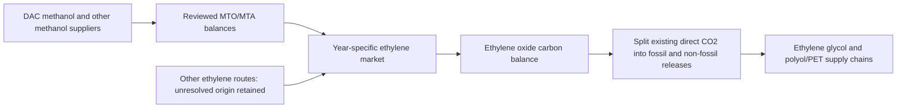
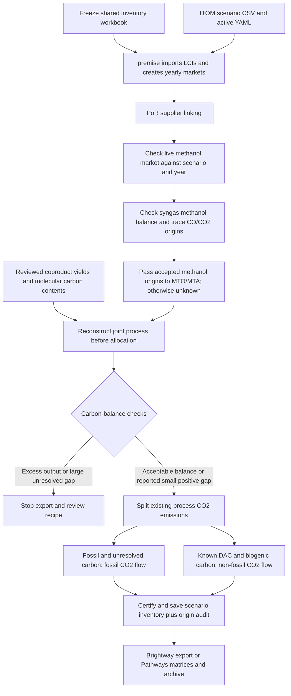

# Scenario-specific CO2 origins in syngas methanol, MTO/MTA and ethylene oxide

Notebook 1 checks **stage-based syngas methanol, MTO/MTA and regionalized ethylene oxide** before
export. The shared `inventories/lci-itom_por.xlsx` remains the reference recipe.
Each CL/OCE scenario and year receives its own fossil/non-fossil emission split.
Steel scopes skip this adapter and do not read the PoR workbook.

## Ethylene-oxide correction

The adapter also targets `ethylene oxide production, ethylene oxidation`,
reference product `ethylene oxide`, in NL. This activity is selected through the
active YAML's **regionalize** list, rather than a production-volume pathway.
It is checked in every PoR scenario/year, including 2025, even when MTO/MTA are
inactive. A missing configured NL activity fails preflight instead of silently
skipping the correction. Steel scopes remain unaffected.



Ethylene carbon is traced through the actual linked market, with the same
case/year supplier-share validation used for methanol and syngas. Reviewed
MTO/MTA suppliers pass their accepted feedstock-carbon fractions to ethylene;
unreviewed routes retain unknown origin. Emission labels are never used to infer
feedstock origin. This assumes homogeneous carbon mixing across coproducts.

The inspected NL process consumes 0.7959705 kg ethylene/kg product and emits
0.499546 kg CO2/kg product. Its direct inputs contain no combustion fuel.
The balance includes product carbon, CO2, CO, methane, ethylene/ethylene-oxide
emissions and organic-carbon releases. Possible DOC/TOC overlap is bounded
between their maximum and sum. Unspecified NMVOC carbon is bounded between zero
and its total mass. BOD/COD are not counted as additional carbon. The resulting
residual range is approximately **−0.14% to −0.18%**, within the unchanged 0.5%
tolerance. No flow quantity is changed to force closure.

Only the existing **CO2** exchange is split. Its total amount, air subcompartment,
scaled uncertainty, utilities and other biosphere exchanges remain unchanged.
Fossil CO and methane participate in the balance but their origin labels are
not modified by this extension. A new direct fuel input requires review.

The saved 2050 CL inventory gives an illustrative proposed split of **0.257411 kg
fossil-labelled CO2 + 0.242135 kg non-fossil CO2 per kg ethylene oxide**. This is
an inventory preflight, not a recalculated PET/polyol footprint. Unknown carbon
retains the fossil label. No additional atmospheric uptake is added.

Native premise background recipes may omit biosphere `input` addresses until
export. The adapter uses the builder's configured biosphere database and the
version-specific UUID for the original air compartment. It does not substitute
an unspecified compartment or guess a database name.



## What changes

`por_carbon_emissions.py` runs after native updates and PoR supplier linking.
It reads the active external package's config, inventory and scenario CSV,
checksums them together with `configuration_file/por_carbon_emissions.yaml`, and
checks that the linked methanol market matches the selected case/year.
Intermediate-year provider volumes are interpolated linearly before calculating
shares; percentages are not interpolated independently of volumes.

Provider comparisons permit a **declared** provider with a numerical-zero share
on only one side of the comparison (absolute tolerance `1e-12`). For example,
premise's interpolation produced an FB_6a CO share of `1.1866e-18` in 2040 OCE
where the scenario CSV contains zero. This is accepted without removing or
rounding the actual exchange. Undeclared suppliers, meaningful omitted/extra
providers and wrong nonzero weights still stop export; mismatches report the
actual and expected weights.

Origin shares follow **actual linked suppliers**, weighted by kg of carbon:

- The explicitly named DAC-methanol import is a DAC-carbon anchor.
- The reviewed coal-methanol anchor is fossil.
- Methanol synthesis from syngas follows its carbon-bearing CO/CO2 inputs only
  when its recipe passes the same physical-boundary check used for its emission
  split. Its emitted CO2 label is never used to determine methanol's origin.
- Reviewed source anchors can be extended through the policy's `source_origins`
  list, with evidence. Do not infer biogenic content merely from a waste label.
- Other waste, gasification, imported and unanchored cyclic supply remains
  **unknown**. Its emissions keep the fossil label, and the unresolved share and
  supplier identities are reported. This is a conservative treatment, not proof
  that this carbon is fossil. Current waste-origin coverage is incomplete.

The reviewed process assumes homogeneous mixing of external feedstock carbon
across products, flue gas and capture. Internal recycle is already embedded in
the stage-based recipe and is not an additional external input. Positive CO2
make-up exchanges are counted explicitly. H2 and electricity contain no carbon.

For each existing positive process-CO2 exchange:

```text
non-fossil CO2 = original CO2 × (known DAC fraction + known biogenic fraction)
fossil CO2     = original CO2 × (known fossil fraction + unresolved fraction)
```

Their sum remains exactly the original emitted CO2. Both branches retain the
appropriate scaled uncertainty distribution. The target biosphere UUID is looked
up for the installed builder's ecoinvent version and the original air
subcompartment, using the configured biosphere database. A missing UUID stops export.

**DAC and biomass remain separate in the audit** even though both use the
existing `Carbon dioxide, non-fossil` release exchange. That flow mapping is an
explicit inventory interface convention, not a claim that DAC is biological.
No characterization factors are installed or edited. The climate consequence
depends on the LCIA method's treatment of uptake and release. Check both flow
factors and method version when interpreting the recalculated climate results.
In particular, do not add another DAC uptake credit: uptake already exists in
the DAC supply inventory. See [ecoinvent's IPCC guidance](https://support.ecoinvent.org/guidance-on-ipcc-methods).

Purchased electricity, steam and heat retain their upstream emissions. Captured
CO2/storage service amounts, allocation factors, heat substitution credits,
material demands and non-CO2 biosphere flows are unchanged. A newly introduced
direct auxiliary-fuel input stops adaptation until its emissions are decomposed.

## Carbon-balance interpretation

The mass-allocated recipes are reconstructed using the documented total joint
material yield per kg external methanol. They are **not** tested as if one kg of
allocated ethylene were the complete physical output of a plant. All material
coproducts, including H2 where it participates in mass allocation, are included;
H2 contributes zero carbon. Emitted and captured CO2 are distinct outputs.

The current November 2026 recipes have positive residuals of approximately:

| Process | Unaccounted input carbon |
| --- | ---: |
| MTO mode 1 | 1.61% |
| MTO mode 2 | 1.11% |
| MTA mode 1 | 3.03% |
| MTA mode 2 | 2.07% |
| Syngas methanol, per kg methanol output | 8.10% |

### Syngas-methanol extension and current hold

The single-product syngas-methanol process is checked per **1 kg methanol output**;
no coproduct-allocation reconstruction is needed. Current carbon inputs are
0.9792996 kg CO and 0.2638113 kg CO2 per kg methanol (H2 is carbon-free). They
contain **0.491934 kg C**. Methanol output and the existing **0.283010 kg emitted
CO2** account for **0.452091 kg C**, leaving **0.039843 kg C**, or **8.10%**, unresolved.

That exceeds the existing 5% acceptance bound. The new policy therefore reports
`balance_review_required`, preserves the existing fossil emission and passes
**unknown** methanol origin to downstream MTO/MTA for this supplier. This is an
explicit, process-specific conservative hold, not a relaxation of the tolerance.
Other accepted MTO/MTA recipes continue to split their supported DAC/biogenic
fractions. Their known DAC-methanol import is unaffected by the hold.

Before this syngas route can be relabelled, reconcile its CO/CO2 input basis,
possible internal recycle, flue-gas amount and any missing carbon-bearing output
with the inventory author. Do not add approximately 0.146 kg CO2 to make the
equation close without source evidence. The workbook is unchanged by this
extension.

For a corrected, accepted recipe, the adapter splits its existing process CO2
using carbon-weighted CO/CO2 origins and propagates those **same** fractions into
the methanol market and downstream MTO/MTA. Evaluation is independent of activity
ordering, and repeat runs do not split already adapted emissions again. Both the
methanol and syngas CO/CO2 markets are checked against the ITOM case/year. Report
fields distinguish feedstock `origin_fractions` from applied
`emission_origin_fractions`; a held recipe has unknown applied emission origin.
`process_basis` and `*_kgC_per_process_basis` identify the denominator explicitly.

The MTO/MTA residuals are **unresolved physical gaps**, not rounding closure or verified carbon
storage. They are reported without inventing an emission, product or removal.
Homogeneous origin splitting of the existing emission is still applied as a
screening assumption. The policy distinguishes a 0.5% balance tolerance from
a **5% maximum positive residual acceptance bound**. The latter is an explicit
screening limit, not evidence that the recipes close to 5%. Outputs exceeding
inputs beyond the 0.5% tolerance, larger positive gaps or a changed allocation
basis stop export. These bounds are visible in the YAML for review.

Legacy/initial MTO/MTA recipes without reviewed joint yields and a decomposition
of process versus fuel CO2 are reported as `legacy_recipe_review_required` and
are not automatically relabelled. The currently active rebuilt YAML selects the
reviewed stage-based recipes. Merely retaining a legacy activity in the workbook
does not make it an active pathway or validate its carbon balance.

## Running and reviewing

1. Run notebook 1's normal input and scenario setup. Its inventory snapshot is
   still taken once before either export route.
2. Run the Brightway or Pathways export cell. Both explicitly show the adapter
   attachment after supplier linking. No separate notebook or manual Excel edit
   is needed. Pathways mapping/classification preflight follows adaptation.
3. Inspect the notebook's case/year/change-count summary and the per-scenario
   JSON reports under `export/por_carbon_emissions/`. Each includes activity-level
  original/split CO2, origin fractions, balances, unresolved suppliers and input
   hashes. The ZIP additionally contains `por_carbon_emissions.json`.
4. Recalculate notebook 2 from the newly exported package. Existing packages,
   result files and figures are not retroactively corrected.

The adapter stages changes before publishing scenario references. Native premise
stores are forked, certified, checkpointed and rebound to their mappings; legacy
list/cache exports use copied recipes and new cache files. Reapplying the same
adapter does not split an already split activity again. Source/policy changes on
an adapted inventory require a fresh build.

The optional physical-carbon/lifetime workflow in `carbon_accounting.py` remains
read-only and separate. Its unknown-source padding is not used to certify these
process balances. This adapter changes exported production inventories; it does
not make the additional lifetime analysis a cradle-to-grave LCA.
